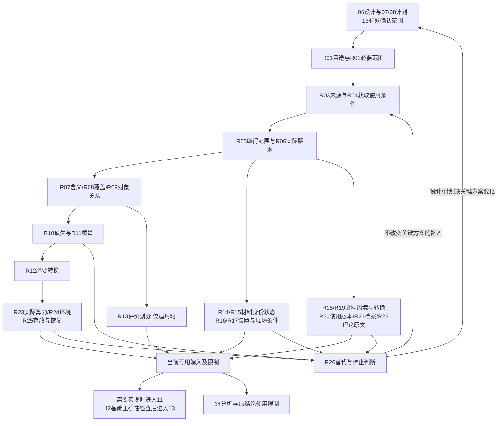

# 数据与资源阶段详细手册

## 本阶段回答什么

本阶段回答：**前序方案需要的输入和条件，是否已经落实到可以使用、可以解释、可以追溯的程度？** 研究人员进入本阶段时，先把方法所需资源与已有资源对照，再核查获取条件、实际内容和质量，做必要准备，最后把可用输入及限制交给实现和基础正确性检查。这里的“资源”可以是数值数据、实物材料、访谈与观察语料、档案、理论文献，也可以是设备、人员、场地、算力与软件环境。

职责与顺序依据[当前完整流程](../docs/workflow-design.md)；确认、任务、独立验收、交接、回退与临时材料规则引用[00共用规则](../00-阶段交接关系/阶段交接关系.md)。普通目录查阅、元数据核对和资源方案草拟可以先准备；真实资源落实承接06方法设计、07／08计划和13有效的实验启动确认。研究性试运行、材料鉴定实验、正式访谈或观察、正式取证仍在相应确认范围内安排，不用“资源检查”名称扩大授权。

本阶段不重新选题、选刊或制定研究方法。实际资源不符合设计时，说明差异及其影响，返回最早受影响的阶段。已有数据的结构与可用性检查属于这里；结果分析在14，结论判断在15。将语料整理为可读形式属于准备；解释性编码、主题形成、理论推导和证据综合本身按06／07确定的路线进入13。无需代码的研究可以从资源准备进入12。

### 从哪里开始，做到哪里停止

上游应提供当前有效的问题、研究对象、方法所需输入、必要证据范围、拟采用的对照或比较、预算与停止条件，以及对应确认范围。AI先读取和复用这些内容，只补影响资源选择的缺项；用户不知道时，AI查清候选来源和术语，解释可行选择，不要求用户先交一份完整数据清单。

完成不等于把所有资源做到最高规格，而是：必要输入确实可用，关键含义与质量判断有依据，准备过程可追溯，关键条件已落实，未决项不会被下游当成已成立的事实。小范围贡献使用与其主张相称的资源；更广泛的推广或比较才需要相应覆盖。充分性来自前序设计，不来自文件数、样本行数或设备价格。

本手册按资源准备的不同问题组织26个考虑节点。它们是研究覆盖，不是26项固定任务、26份文件或统一问卷。未来使用时，按用户任务选择节点，再补齐其前提，形成所需子图。

## 一、把前序证据需求落实到资源

### R01 必要资源与方法中的角色

先从每项必要证据反推输入：要测量什么、比较什么、解释什么，分别需要何种资源，以及最少需要哪些属性。例如方法比较需要目标任务、比较对象和共同评价输入；档案研究需要与问题相关的原始材料及形成背景；理论研究需要命题、定义、前提和可核对原文。不能因为已有某个大数据集就把研究问题改成适合它的题目。

AI把已有方案中的需要整理成简短对应关系：“证据用途—所需资源—关键适用条件—当前是否已落实”。用户不知道某资源为何必要时，用一个缺少它会怎样改变判断的例子解释；仍不知道时先给出“采用现有可解释资源／核查另一来源／调整前序设计”几种具体路径。多个证据用途可以共用同一资源，不重复获取。

此时够用的程度是能区分必要项、可替代项和可选扩展，并指出会阻碍下一步的缺项。设计中缺少关键测量定义必须先回06；只缺某份材料的取得状态可在本阶段查清。对于自采研究，此时落实的是抽样入口、仪器、访谈提纲、记录方式等准备条件；正式数据形成在13，不能提前声称样本已经齐备。资源的用途和限制可借鉴[Hugging Face数据卡](https://huggingface.co/docs/hub/datasets-cards)的说明方式，但数据卡不证明一个数据集适合本课题。

### R02 复用已有资源，按贡献范围判断够不够

先核查已有输入、说明书和检查记录是否仍与当前对象、版本和方法匹配。有效的已有成果直接复用；只补版本、来源、质量或覆盖的真实缺口。扩大资源规模需要能说明它支撑了什么新增判断。样本量、精度、语料范围或文献覆盖已由06／07决定时，本阶段核对实际达到情况，不另定统一标准。

AI向用户解释资源不足的具体后果：缺少某地区会限制外推，缺少某时期会阻碍历史比较，缺少某版本原文会使理论命题无法核实。用户不知道是否需要扩展时，先对照“当前有限主张能否成立”，再提出最小补充与缩小范围的成本比较，而不是默认增加所有可能数据。

够用时可以保留明确限制。例如区域个案不必自动补全国覆盖，理论短文不必收尽所有相关文献，方法可行性研究也不能在只有可行性输入时宣称普遍优越。若资源缺口迫使核心方法、待检验结论或关键资源安排实质改变，按00返回相关设计、计划与13确认位置；未影响主张的可选扩展可以后移。UK Data Service强调数据管理应与项目规模和复杂度相称，适合作为这一取舍的依据。[官方基础说明](https://ukdataservice.ac.uk/learning-hub/data-producer-support/foundations-of-research-data-management/)

## 二、来源、获取与版本

### R03 选择真正对应问题的来源

来源选择先看生成方式和适用范围，再看容易下载与否。区分数据生产者、托管仓库、汇总网站、论文附件和二次加工数据。数据库名称相同不等于测量定义相同；多个网站重复转载同一来源，也不构成多份独立证据。

AI先找一个最贴近所需事实的主来源，再为明确缺口找补充来源。用户不知道来源优劣时，展示两三个候选的对象、时间、字段、生成方法、限制和取得成本。进入仓库的记录页后，阅读README／数据卡、代码本、方法文档和原始引用；不能只读摘要、预览截图或下载次数。官方数据库的“权威”也只针对其职责范围：行政统计不能自动代表未登记人群，商业语料不能自动代表完整社会话语。

本阶段够用的是能够说明为何采用该来源、哪些条件不覆盖，且主要资源可定位到稳定记录。来源不明、所需对象根本不在其收集范围内，应先解决；辅助背景材料的更多来源可后移。网上[database-lookup Skill](https://github.com/K-Dense-AI/scientific-agent-skills/blob/main/skills/database-lookup/SKILL.md)提供按检索对象选主来源、记录筛选语义的思路，本流程只借鉴检索可追溯性，不照搬其数据库清单或工具限额。

### R04 区分可见、可取得和可按计划使用

网站公开展示不等于完整文件可取得，账号可登录不等于能导出，能阅读也不等于能再次分发。对本课题实际需要的用途查清：研究使用、加工、人员访问、受限场地、保留期限，以及后续论文中能公开哪些内容。材料转移、设备使用、访谈语料复用等按实际来源条件核对必要许可，不给所有研究增加一套无关手续。

若涉及人源样本或可识别资料、实验动物或受限生物材料，按实际所在地、机构及提供方的现行规则，由有权判断者核定本用途所需的伦理审查或豁免、动物方案、材料转移与场地准入；在同一资源说明中记录决定的适用对象、范围、有效状态和限制。必要条件未落实前，不开展受其约束的取材或操作；AI不能只因样本“已编码”或资料“公开可见”就自行认定免审或可用。[HHS人源编码资料指南](https://www.hhs.gov/ohrp/coded-private-information-or-biospecimens-used-research.html)、[NIH动物研究要求](https://www.grants.nih.gov/grants/policy/nihgps/HTML5/section_4/4.1.1_animal_welfare_requirements.htm)和[Addgene材料转移说明](https://www.addgene.org/techtransfer/)分别说明其自身适用情境，不能当作各地区统一规定；13的实际资源与许可就绪检查承接本项结论。

具体操作是进入来源记录的“Access／License／Terms／申请条件”等页面，核对适用对象和版本，把会影响计划的条件写在同一资源说明中；受控资源再查等待时间、机构资格、可用字段与允许输出。UK Data Service明确区分开放、受许可和受控访问，可用其[访问类型说明](https://ukdataservice.ac.uk/help/access-policy/types-of-data-access/)解释这些差别。FAIR允许必要的认证与授权，不等于所有原始资源必须公开。[FAIR原则](https://www.gofair.foundation/fair-principles)

用户不知道如何处理时，AI先说明“现在能使用什么、缺什么条件、替代方案能保留什么判断”；正式申请、付款或对外联系依用户实际授权安排，本轮不执行。必须在真实使用前查清的是必要许可与访问条件；最终公开哪些非必要附件可在后续交付阶段细化，但不能把取得不到的关键资源写成已经落实。

涉及人的材料还应区分参与、录音／观察记录、委托处理、当前研究中使用、公开引用及未来再使用；它们未必属于同一个同意范围。AI根据已有方案和实际来源条件帮助用户检查必要安排，新收集路线先准备相应程序；既有材料则核对允许的当前用途，不能把匿名化当作自动取得使用权。UK Data Service的[2026知情同意指南](https://ukdataservice.ac.uk/app/uploads/consentformguidance.pdf)按参与、研究中使用及未来复用分别说明；其中英国制度背景须按实际机构与地区适配。

### R05 取得范围是否完整，查询是否可重复

资源获取应与预定范围一致，特别防止只拿到搜索首页、API第一页、部分字段或浏览器当前筛选结果。检索条件需区分网站实际执行的筛选与取得后仍需核查的条件；集合的总覆盖不证明每个文件都有所需时空内容。

以World Bank指标为操作例：先确认指标代码与定义、国家或汇总地区、时间范围；按[官方API说明](https://datahelpdesk.worldbank.org/knowledgebase/articles/898581-api-basic-call-structures)设置国家／指标、`date`、返回格式和分页。需要完整范围时核对总记录数、各页取得数及后续筛除数；无需全量时明确此次只核查哪些范围。记录请求参数、取得日期、筛选条件和返回状态；本轮只阅读文档，不发起真实课题的数据请求。

AI发现结果为空时依次核对标识符、筛选语义、来源覆盖和访问状态，再考虑替代来源，不把“未检索到”写成“世界上不存在”。用户不知道完整性要求时，AI由07所需证据解释为什么要全量或为什么局部已够。完整性无法验证时明确限制与停止条件；分页未完成且直接影响必要输入时先解，额外无关字段可以不取。可借鉴[检索契约配套说明](https://github.com/K-Dense-AI/scientific-agent-skills/blob/main/skills/database-lookup/references/retrieval-contract.md)，其中的固定调用限额是该工具实现约束，本流程不据此增加确认关口。

### R06 固定实际采用的来源版本，而非只记网址

同一网址可能指向持续更新的内容。区分采集日期、发布时间、修订时间、数据库发行版和本地取得时间；文献、档案数字化件、材料批次和设备校准记录也各有版本。需要历史信息状态的研究不能悄悄改用最新修订数据。

在资源说明中保留实际采用的标识符、版本／发行日期、文件名或材料批号、取得方式与必要校验依据。可取得文件时按需要用校验和识别“这份文件”，但校验和只证明内容一致，不证明科学正确。公开仓库存在具体版本标识时引用该版本；Zenodo为文件更新建立新版本记录并提供独立持久标识，适合说明为什么应保留具体版本。[版本说明](https://help.zenodo.org/docs/deposit/manage-versions/)

用户不知道哪个版本合适时，AI先看上游问题需要的是当前状态还是当时可知状态，并说明各版本的变化。影响单位、字段、样本、正文或关键材料性质的版本差异先解决；仅目录描述更新可在不改变输入的前提下补记。下游11、12、14及22都引用这一正式来源说明，不各自维护互相冲突的来源版本。

## 三、数字资料的含义、结构与质量

以下节点适用于含结构化数字、影像或测量内容的研究。访谈、档案或理论研究只选择真正需要的部分。

### R07 字段含义、单位、编码与测量尺度

“列名看起来像年龄／浓度／收入”不能证明它的定义。核对变量对象、单位、尺度、允许取值、分类标签、精度、检测或适用条件、派生方式，以及同名字段在不同来源中是否一致。说明书没有写明的单位记为未知，不能从数值大小猜定。

AI先阅读代码本、变量说明与原研究方法，再挑下游会用的字段形成简洁数据字典；不要求给所有不用的字段写长解释。用户不知道字段意义时，先用常见误解解释，比如百分比与比例相差100倍、名义金额与不变价金额回答不同问题，再给候选解释及可核实出处。定量研究中的数值之外，还需保留测量对象与适用人群。UK Data Service的[数据层文档说明](https://ukdataservice.ac.uk/learning-hub/data-producer-support/preparing-data-for-sharing-and-reuse/documenting-and-describing-data/data-leveldocumentation/)同时覆盖变量、缺失代码和文件关系。

够用时，下游能理解必要字段而不靠作者口头补充。决定变量科学含义、单位和缺失编码的未知先解；未采用字段的细节可后移。单位转换只在已知定义下进行，公式与原单位写入R12准备记录；变换后解释改变时回06／07核对。

必要字段若是人工类别、掩膜、评分或被当作参照的结果，还须读[参考值与人工标签形成过程](#reference-label-formation)，不能用列名“真值”代替其定义与依据。

采用概率调查资料作总体估计时，必要字段还包括适用分析权重、分层／PSU或复制权重及其原指南；保留权重覆盖的人口、波次、问卷组合、缩放与零／缺失含义，不能只交一列“weight”。具体选用、设计声明、域分析及分母／方差核查统一见[14概率调查分析操作](../14-结果分析/结果分析阶段详细手册.md#complex-survey-analysis-workflow)，本阶段不因读到某列名便认定已适用。

### R08 时间、空间、分辨率与对象覆盖

核对时间戳表示采样、上传、发表还是统计期，时区与日历是否一致；核对坐标系、地点边界、观测区域和分辨率。年度平均不等于某一天，栅格像元不等于个体，行政区变化也会破坏简单年度拼接。数据记录的范围必须对应问题，而不是只看资源标题。

Earthdata Search可作为操作示例：按变量或产品搜索，使用Temporal和Spatial缩小范围，进入集合与文件层元数据，分别检查时空覆盖、分辨率、处理级别与版本。NASA的[发现界面](https://search.earthdata.nasa.gov/search)和[官方元数据访问示例](https://access.earthdata.nasa.gov/collections/C1276812830-GES_DISC)实际提供这些项；这只示范地学资源核查，不规定其他学科采用NASA格式。

用户不知道分辨率够不够时，AI用所需变化的尺度说明：若问题发生在短时或小区域，粗粒度资源可能掩盖变化；若只比较多年地区概况，粗粒度可能已足够。关键时空覆盖和粒度不匹配先解，补充视觉底图或无关时期可后移。不得为整齐而未经设计随意聚合、插值或换坐标；必要处理写入R12，并把由此产生的限制交给14／15。需要逐像元组合图层时，按[共同格网与有效区域操作](#resource-detail-raster-alignment)准备，不能只核坐标系和分辨率相同。

### R09 标识符、层级、重复与连接关系

先弄清一行或一个对象代表什么，以及它与人、样本、访谈、地点、材料、测次或文件的关系。重复观测可能是合法重复测量；相同行也可能是重传副本。不能用简单“删重”把复测、配对或证据不同版本抹掉。合并数据前还需知道连接是一对一、一对多还是多对多。

AI检查必要标识符的唯一性、缺失、跨文件一致性和层级；连接前核对标识体系及版本，连接后比较记录数、匹配与未匹配数、重复展开情况，抽查不同类型的对应例。用户不知道为何行数骤增时，用一个人多次观察或一个档案有多个数字化页的例子解释连接关系。来源名称或相似字符串不能自动作为实体等同的依据。

够用时有稳定标识或明确的代用规则，并能保留真正的独立单位与重复层级。关键身份对应不明先解；没有采用的辅助联表可以后移。若发现原计划将测次、图片切片或文章多个版本当独立样本，回06／07修正而不是在本阶段补算显著性。网上[EDA Skill](https://github.com/K-Dense-AI/scientific-agent-skills/blob/main/skills/exploratory-data-analysis/SKILL.md)可借鉴其结构与检查范围说明，自动检查仍不能证明独立性。

### R10 缺失、零、不适用与未检出

缺失至少先按来源含义区分：未采集、未回答、不适用、未公布、设备失败、低于检测条件和真实零。统一空值只是软件表示，不能把不同原因在科学上混为一类；历史资料缺页、录音不可辨和访问受限也不是“没有发生”。

具体核查是读取代码本和来源约定，再查看必要字段的缺失数量及在时间、批次、地点或其他既定分组中的分布；记录检查是全量还是抽样。原有特殊数字编码保留来源解释，转换为分析软件空值时另保留必要的原因字段或映射。Data Carpentry演示了零与空白、缺失代码混用造成的问题，实际约定须按软件与来源决定，不能一律把空白视为最优格式。[官方教材](https://datacarpentry.github.io/spreadsheet-ecology-lesson/02-common-mistakes.html)

用户不知道缺失能否补时，AI先解释缺失发生在哪个过程、会影响哪项比较，再提出“从原始记录核实／保留并按设计分析／资源不足需调整范围”；不得自动均值填补或把缺失机制当成已被证实。必要字段大量缺失、无法区分零与未测时先处理；不阻碍执行的缺失原因不确定可交14开展与主张相称的敏感性分析，并说明暂不能判断。

### R11 质量核查的范围、异常与修复依据

质量分为至少三个不同问题：文件能否读、内容是否符合已知定义、来源是否适合研究问题。前者通过不保证后两者。核查针对必要字段和07给出的质量需要：类型与取值、记录完整性、时间次序、逻辑一致、关键分组覆盖、来源质量标记，以及人工录入或转录的代表性核对。

小表可在副本中利用电子表格的数据验证、整表排序和筛选发现非法值；注意排序时保持整行关系。大型文件按已知时间、批次或地点分层检查，不把有序文件前几行当随机样本。Data Carpentry的[质量控制教程](https://datacarpentry.github.io/spreadsheet-ecology-lesson/04-quality-control.html)给出这些基本操作；对领域格式还需专用检查方法，通用工具只说明实际检查到的范围。

AI把异常标为待核实，追到原始记录、设备标记、提供者更正或可解释生成过程；用户不知道如何判定时，解释“录入错误、真实极端、状态变化”各需什么依据。禁止为了让分布好看删除异常。已证实的录入修复说明原值、依据、改法和影响；未解释但不阻碍执行的异常保留并交14分析。关键字段损坏、质量条件达不到或修复需要猜值时先解或回设计。R11报告的观察不承担15的结论验证。

标签争议还应区分材料不足、定义含糊、判断差异和可核实错误，按[形成过程](#reference-label-formation)保留依据；一致率高不单独证明参考正确，意见不一致也不一律属于应修复的脏数据。

### R12 必要格式转换与派生准备

只做下游真正需要的转换：编码、日期解析、结构整理、单位换算、宽长表重排、经设计确定的坐标或格式转换。原始文件、扫描件、录音与仪器原始输出保留；派生版本能回到来源。表格转换尤其检查前导零、长数字、日期自动识别、字符编码、公式与显示值、空值表示；图像或谱线转换检查精度、维度、轴、单位和相关元数据是否保留。

每种转换说明原因、输入版本、规则／公式、参数、输出与已知损失；转换前后核对必要的记录数、对象数、范围和代表例，不能只看文件成功保存。需要解析罕见或专有格式时先读对应官方格式说明和原软件导出选项；不因为通用EDA工具列出格式名称就声称支持完整内容核验。

人工整理少量数据可以使用已有电子表格或文本工具；批量文本类清理可选择OpenRefine：在派生副本导入，查看Facet／Filter，核查候选变更，再用Undo／Redo查看历史、Extract导出可复用操作；单格手工编辑等不能提取的变化另外简记。导出前核对是否仍有筛选，因为部分导出只包含当前可见行。[官方历史与导出说明](https://openrefine.org/docs/manual/running) [转换说明](https://openrefine.org/docs/manual/transforming)

用户不知道要用哪种工具时，AI按转换量、可复现需要和已具备环境给出最小方案；本轮不安装。够用时下游格式可读、含义保留、变更可重做。必要字段的不可逆损失先解；代码化复杂转换交11实现、12核验，不在本阶段另造一套实现流程。会依据结果重新选取变换的处理回07，不能包装成普通格式准备。

### R13 训练、验证与测试边界，仅在相应研究采用

模型评价或方法泛化研究需继承07已确定的划分单位与比较逻辑，检查同一人、地点、时间片段、重复文本或派生样本是否跨集合。按行随机拆分未必符合研究对象。数据准备不能用测试集信息学习插补、缩放、特征选择或其他参数后，再把它称作独立评价。[scikit-learn官方例子](https://scikit-learn.org/stable/common_pitfalls.html)展示了预处理泄漏及先划分、仅在训练数据学习变换的做法。

AI向不知道的用户解释“用于调整方法的资料”和“最后检验方法的资料”的角色，记录划分标识、对象层级、规则及已有来源重叠；无法取得独立测试条件时说明实际评价范围，回06／07决定是否改为内部评价或限定主张。必须先解决的是会使评价失效的边界不明与对象交叉；正式指标值和结果解读留13／14。无需预测评价的质性、档案、理论或普通描述研究不套训练测试划分。

## 四、实物材料、设备与现场条件

### R14 材料身份、批次与实际状态

材料名称相同不保证性质相同。核对来源、标识、规格、批号、数量、保存历史、已有质量证明和与07条件的匹配。对细胞、质粒、试剂、样品、标准物质等，按各自领域判断必要身份核查，不能将一种领域检查清单套到所有材料。

具体网站操作示例：在Addgene按质粒编号进入记录和数据页，查看序列、来源文章、提供者说明及接收处理要求；其官方建议在使用前核查关键序列或酶切信息。[处理与身份核查说明](https://www.addgene.org/recipient-instructions/myplasmid/) ATCC则说明细胞身份、污染与传代记录影响可重复研究，可在相应条目和既有证书中核对编号与适用批次。[细胞鉴定说明](https://www.atcc.org/resources/technical-documents/cell-line-authentication-test-recommendations)

AI向不知道的用户说明“供应记录、接收后状态、当前是否适用”是三件事，先查已有证据，再提出与方案相称的鉴定或替代。读取既有证书和库存属于准备；实际鉴定操作按确认范围进入12或13安排，不冒充本轮已经检验。够用时关键材料可识别且当前状态有依据；身份或批次关系不明先解，非必要的扩展材料可以后移。领域专用条件随实际材料而定。

### R15 到货、保存、有效期与消耗相互约束

资源“已找到”不等于能在需要时使用。把交付期、保存条件、有效期、可用数量、耗损、复测需要和设备排期放到同一可行性判断中；不能设备到位时材料已经失效，也不能把名义库存全部当可用数量。

AI先用现有供应方说明与库存记录核对条件，再对07预算提出具体差异，例如当前数量只够原计划的一部分，或到货期晚于固定观察窗口。用户不知道余量如何定时，先依步骤的实际消耗和已有失败／复测依据估算，不统一追加某个百分比。不同材料保存方式差异很大，Addgene的[接收说明](https://www.addgene.org/recipient-instructions/myplasmid/)可用于示范“按实际交付形态核对”，其温度和时限不适用于其他材料。

够用时有可用时间窗口、数量和必要保存条件；等待到货可以作为明确未落实项继续做无依赖准备，正式使用前必须解除。额外储备可在不影响必要研究的前提下后移。若替换材料改变研究对象或机制，回06／07；若只有同等规格补充且属于既有确认范围，按00继续独立验收。采购、申请或外部联系不在本轮执行。

### R16 设备适用性、校准与测量依据

先比对设备能测什么、量程、分辨率、实际精度、环境要求和输出格式，与07需要的测量差异是否相称。铭牌“精度高”或“可追溯”不能替代对实际测量用途的判断；校准记录需对应设备、条件、时间和测量量。

AI读取现有设备手册、校准证书和适用记录，说明不确定度是否足以区分计划中的差异。NIST明确指出计量溯源本身不保证适用，还需满足具体测量对不确定度的需要。[计量溯源官方说明](https://www.nist.gov/metrology/metrological-traceability) 标准物质也应核对证书、特性值、适用基体、保存和有效条件，不能因为使用过某个标准就给所有结果贴溯源标签。

用户不知道设备要求高低时，AI给出“当前装置支撑的判断、租用／共享装置能新增的判断、缩小测量主张”的比较。资源准备阶段够用的是适用条件和已有依据明确；实际基础测量正确性由12按方案检查。缺少会影响核心测量的校准或范围资料先解，未用功能的全面认证不列为本课题任务。设备更换影响方法或测量条件时回前序，保留不受影响的资源成果。

### R17 操作者、场地、预约与资源说明是否一致

设备能够借到，也可能缺少能操作的人、适用场地、采样通道或时间窗口。按实际研究核对必要能力、可用时段、访问条件、记录方式和责任接口；档案阅览或访谈进入场域也可需要这些条件。训练、资质或场地限制仅在来源与方法确实要求时纳入，不生成与课题无关的检查。

AI读取机构设备服务说明、已有操作者或场地安排，交代实际限制怎样影响步骤。用户不知道如何选择时，给出使用现有能力、采用机构服务、改变时间安排或调整方法的最小可行选项。记录可用条件及依据，复用机构已经存在的预约／库存／实验记录系统；无需新建本流程专属系统。

本轮阅读[LabArchives integration Skill](https://github.com/K-Dense-AI/scientific-agent-skills/blob/main/skills/labarchive-integration/SKILL.md)，只借鉴库存与记录系统要区分接口、权限和实际可用范围，不把该产品设为默认配置。协议来源可参考[protocols.io integration Skill](https://github.com/K-Dense-AI/scientific-agent-skills/blob/main/skills/protocolsio-integration/SKILL.md)保留具体协议版本的思路；协议网页可见也不证明它适用于当前材料与装置。关键操作者、场地或访问条件在执行前落实；纯展示、额外自动化和系统迁移可后移。

## 五、质性语料、档案与理论文献

### R18 语料单元、场景与材料边界

访谈、观察笔记、日记、论坛文本或视觉资料，需要先知道材料单元是什么、何时何地由谁以什么方式形成、怎样对应研究对象，以及与其他材料的关系。长篇文本不等于更充分；来源丰富也不等于已覆盖关键对比。已有语料的选择边界承接06／07，自采研究在本阶段准备入口和记录条件，实际收集在13。

AI先阅读数据列表、访谈提纲、来源说明和相关背景，向不知道的用户解释“这段材料能够反映什么经验、无法代表哪些情况”；材料缺乏形成背景时优先补已有上下文，而不是让AI按常识补故事。UK Data Service的[数据层文档](https://ukdataservice.ac.uk/learning-hub/data-producer-support/preparing-data-for-sharing-and-reuse/documenting-and-describing-data/data-leveldocumentation/)给出文本唯一标识、日期、语境及文件联系的具体依据。

够用时每个必要材料可定位且关键语境可理解，范围与计划一致。关键角色或场景缺失须先判断影响并回设计或补资源；不影响解释的背景细节可以在13研究中继续记录。这里不设统一访谈人数、不提前宣称饱和，也不把是否取得预期主题作为准备通过标准。

对于质性访谈，Malterud等提出研究目标、样本特异性、已有理论、对话质量与分析策略共同影响信息充分性；本轮实际阅读的是[原论文摘要](https://pubmed.ncbi.nlm.nih.gov/26613970/)，仅借此支持“按具体目标判断”，没有据摘要构造人数公式，也不把这一访谈框架推广到所有档案和理论研究。

### R19 转写、OCR、翻译与原件对应

准备语料先选择与方法相称的转写或数字化细度。内容主题研究与对话互动研究需要保留的停顿、重叠、语气细节不同；OCR和自动转写还可能漏掉表格、边注、专名、否定词和说话人。可搜索文本只是派生层，必须能返回原页、原音或原视频。

AI承接06的分析用途提出转写约定，给不知道的用户展示同一小片段在不同细度下会保留／失去什么。准备时保留原件标识、页码或时间位置、说话人标签、不可辨标记及转换版本；人工核对关键片段和能代表录音条件、文体或页面难度的部分，报告核对范围，不声称抽查证明全文无误。必要翻译保留原文及译文关系，概念有歧义时先查原语境。

够用时材料可以按方法读懂、定位和核实；关键语句不可辨、说话人不清或版本无法对应先解。非核心片段的进一步精细转写可以在13按研究需要开展，但未检查部分明确标记。UK Data Archive的[转写说明示例](https://ukdataservice.ac.uk/app/uploads/ukda-example-transcription-instructions.pdf)直接说明细度与分析有关；该示例采用完整逐字转写，其排版、标签和材料处置安排不自动适用本流程。相关网上[质性研究Skill](https://raw.githubusercontent.com/maydengximin-sketch/qualitative-research-skill/main/SKILL.md)与[数据收集模块](https://raw.githubusercontent.com/maydengximin-sketch/qualitative-research-skill/main/references/03-data-collection.md)已实际阅读，只借鉴方法匹配、统一标识与原音定位，不套其预访谈次数或统一逐句处理要求。

### R20 去标识处理保留可解释语境

去标识需要在实际使用范围和语料解释需要之间处理，不能把所有地点、职业、关系与时间都删掉后仍假定材料意义不变。已经存在的复用条件承接R04；这里处理准备版本中的具体改动及其影响。

AI先依据实际来源和用途区分直接身份信息、组合后可识别信息、解释所需背景，再提出一致化名、角色描述或适当概化等方案；用户不知道时，用“保留哪种语境即可支持本问题”解释取舍。原文与可用派生版本、替换约定和受限对应关系按项目既有记录安排；不把对应表混入公开语料，也不把自动识别当作全文检查。

本阶段够用是当前使用版本满足实际访问条件，同时关键比较语境仍有可解释依据。无法决定是否允许实际使用、关键语境处理后丢失时先解决；最终公开附件的展示形式可在后续交付细化。准备不自动授权将原始访谈上传到外部转写或AI服务。可靠方法依据为UK Data Service[文本匿名化说明](https://ukdataservice.ac.uk/learning-hub/data-producer-support/preparing-data-for-sharing-and-reuse/anonymising-data-and-protecting-participants/anonymisationfortextdata/)；它是方法指南，具体机构和课题条件仍须核对。

### R21 档案层级、来源形成与保存偏差

档案不是脱离形成过程的几段引文。先识别收藏／全宗、系列、案卷、件或页的层级，记录馆藏机构、档号、题名、形成者、时间范围、原件／复制件／数字化件关系，以及是否有缺页、删节、受限或未数字化部分。搜索结果的“没有”可能只反映目录词、保存与数字化范围。

AI把研究问题拆成可检索的人名、机构、地名、时期和可能文书类型，结合目录层级及关联记录核对；用户不知道档案入口时，先用一个系列解释某份材料为什么在该位置，再给可用检索路径。证据用于具体引文时保留档号与页定位，阅读对应上下文，不能靠OCR命中就当作完整原文。档案生成目的、作者位置及保存偏差作为后续13解释的前提，准备阶段登记已知缺口。

具体操作可参照美国国会图书馆的[手稿检索说明](https://guides.loc.gov/american-women-manuscript/use-this-guide/search-tips)：限定手稿或结合其他载体查找，按姓名、题名、主题和关键词检索；目录概括过粗时继续查collection finding aid，再进入系列、卷盒或件。关联人名和机构名可补充某个收藏未直接标出的人物。其[手稿组织说明](https://guides.loc.gov/american-women-manuscript/use-this-guide/understanding-manuscripts)解释形成来源与原始排列；英国国家档案馆[2017目录实践资料](https://cdn.nationalarchives.gov.uk/documents/digital-cataloguing-practices-march-2017.pdf)说明数字原件与替代件、层级、保管历史及访问条件。后者是机构当时实践说明，不是当前通用最佳实践或网站界面验证。

够用时必要材料可以准确找到，版本、上下文和获取条件清楚；核心原件无法定位或关键缺页先解，额外馆藏可以按当前主张需要后移。缺乏材料可能促使调整范围，但不能据此确认历史事件不存在。网上[社会科学方法Skill](https://raw.githubusercontent.com/NVlabs/Skill2Env/main/SkillHub/skills/alterlab-social-science-methods/SKILL.md)及其[档案参考模块](https://raw.githubusercontent.com/NVlabs/Skill2Env/main/SkillHub/skills/alterlab-social-science-methods/references/comparative-and-case-methods.md)已实际阅读，可借鉴来源、可靠性、保存偏差和原语境的问题；其中正式跨藏比较属于13，联系档案员等对外行为不由阅读该模块授权。

### R22 理论文献、定义、命题与版本

纯理论、概念或证据综合研究也有需要准备的输入。理论文献中要区分原作者命题、后续解释、教材改写、译本与勘误；同一符号在不同体系中可能含义不同。这里准备可靠原文和定位依据，推导、理论比较与综合本身按设计进入13。

AI优先定位关键原著／论文及当前勘误、所用版本、具体页节或命题编号；保留原符号与前提，不以AI摘要替代核查。用户不知道应读什么时，先从06当前采用的定义与论证依赖反推必要文献，解释一篇材料支撑哪个前提；只有专题综述设计要求时才扩展检索边界。无法取得全文时明确只能据摘要判断到何处，并寻找合法可用版本或替代论证。

够用时必要定义和命题能追到可核实原文，引用元数据与附件版本一致。关键前提只有二手转述、不同译文或版本导致含义冲突时先解；辅助历史脉络和未采用方法的全面梳理可以后移。

具体管理操作可复用已有Zotero库：优先从出版机构页面或图书馆目录保存条目，已有DOI／ISBN时用Add Item by Identifier，再对原资料核对条目类型、作者、年份、版次和译者，附件关联实际原文，笔记保留页节定位。[官方添加说明](https://www.zotero.org/support/adding_items_to_zotero) [字段说明](https://www.zotero.org/support/kb/item_types_and_fields) 疑似重复在Duplicate Items中先核对，确认同一条目再合并；不同版本、译本或需要比较的修订不能仅因标题相似合并。[官方重复检测说明](https://www.zotero.org/support/duplicate_detection) 不再创建平行书目，保存文献也不等于已经确认其论证成立。

## 六、算力、软件与存储条件

### R23 盘点任务实际可用资源，估算执行负担

需要计算时核对当前执行环境能使用的CPU、内存、磁盘、GPU、调度配额与运行时间，而不是只看主机硬件。共享机器、容器与集群可能有更严格限制；GPU能被管理工具看到，也不保证框架、驱动和所用运算兼容。内存、临时空间和输出空间分别估算，考虑同一时间共存的数据及派生副本。

AI依据输入规模、单个工作单元及现有实现说明估算负担，并标注未知。用户不知道是否需要更大资源时，解释首先受内存、I/O、时间还是加速器限制，再提出分批、流式处理、减少不必要复制、使用现有共享资源或调整范围的比较。网上[get-available-resources Skill](https://github.com/K-Dense-AI/scientific-agent-skills/blob/main/skills/get-available-resources/SKILL.md)区分硬件清单与实际限制的做法可借鉴；本轮没有运行其检测器。

够用时必要计算能够在预算与有效配额中安排，关键不确定项明确。只读环境盘点可按实际任务开展；代表性负荷试运行若产生研究证据或属于预实验，先依00确认范围安排。未知资源上限不能当无限，实际运行能力不足时先解决；无需大量计算的档案、质性和理论研究不因有此节点而申请GPU。

### R24 环境版本、依赖与可恢复性

先复用现有环境，补齐实际方法需要的软件、系统条件、包或应用版本、语言环境、关键配置和必要外部服务。装好软件、能启动软件和实现正确是不同层次；软件可用条件在本阶段落实，方法实现与基础正确性分别交11／12。

若研究使用Conda，可先在目标环境查看实际包与版本，然后按目的导出：便于跨平台重建的环境说明与同平台精确重建的显式包清单并非同一保证；官方文档还区分完整依赖与仅按安装历史导出的信息。[Conda环境说明](https://docs.conda.io/projects/conda/en/stable/user-guide/tasks/manage-environments.html) 实际命令以当前已用版本为准，本手册不默认安装或升级Conda。其他工具使用其官方版本／项目导出方式；图形软件需同时核对原生项目与必要可读导出。

用户不知道是否要容器或新环境时，AI按复现与冲突的具体问题建议最小方案，不把容器作为所有研究的必选项。够用时别人能识别实际环境和关键依赖，有必要的恢复路径。会阻止打开输入或执行所需方法的兼容问题先解；非关键界面偏好、自动化和无关新版本可后移。依赖变更影响数值、解析或输出时补12受影响检查，并传给14。

### R25 存放、备份与恢复应服务于实际依赖

给原始输入、必要派生材料及其说明指定正式位置，保持唯一索引；现有项目安排可直接复用。大规模资源只保留确有需要的本地内容，不为每次查阅生成快照、缓存、状态文件或新目录。原始材料、失败证据及下游引用不作为冗余清理对象。

AI核对实际位置可读、路径／链接能定位、存储容量与必要访问条件相符，按不可再取得材料的风险安排已有备份或恢复办法。不是所有资源都需要多份全量副本：可重新取得的大型公开文件可以记录精确版本与获取方式；唯一录音、原始记录或后续不可访问资料需要实际可恢复依据。UK Data Service的[基础数据管理说明](https://ukdataservice.ac.uk/learning-hub/data-producer-support/foundations-of-research-data-management/)支持组织、说明与长期可理解性，但具体备份策略按实际依赖决定。

用户不知道如何避免文件混乱时，AI先整理引用与正式位置，再说明哪些派生版本必须留下；不直接删除。够用时下游能读取当前输入、理解其来源，关键材料不会只在临时位置。必要文件无法恢复或空间阻碍执行时先解；不妨碍继续的临时残留按00登记，不在本阶段创建另一套清理规则。最终固化与完整归档由22负责。

### R26 替代资源、降规模与停止路径

替代方案必须比较它保留与改变了什么，而不是只比较便宜或易用。替代数据可能改变对象与覆盖；替代材料可能改变机制；替代设备可能改变精度；删减语料可能失去关键对比；用综述替代原文可能使理论前提无法核实。

AI给出少量可行方案，每项说明：仍能支持的必要判断、失去的判断、所需条件、成本／等待时间和是否触发前序变更。用户不知道怎么选时，以当前确认目标为基准解释最小充分路径；若没有路径支撑必要判断，明确资源不足，回06／07调整或按停止条件结束，不伪造可用资源。

本阶段的完成可以是“准备可继续”，也可以是“已证实必要资源当前无法落实，并给出依赖影响与处置路径”。原设计仍成立的部分保留。属于既有确认范围的恢复、补齐与重复准备按00继续；关键数据、核心方法或资源安排实质变化回13商讨确认。可选扩展不要挡住已经具备必要依据的有限研究。

## 七、节点怎样连起来，以及向下游传递什么

### 条件依赖图

以下关系用于按任务选点。箭头传递的是判断所需材料，不表示每节点都必须单独发布任务。

图中条件支路可以并行准备。无代码研究无需经过R23的大规模计算检查；材料研究也无需为了符合图形去建立数值训练集。资源的版本与访问条件是共用前提，更新一次后由相关节点引用。

### 不同任务的最小使用路径示例

这些是纸面示例，不代表已开展研究；例子中的规模与要求由具体课题再确定。

| 研究任务 | 选用节点与关键前提 | 本阶段应留下的判断 |
|---|---|---|
| 用公开统计描述一个地区某时期的变化 | R01—R08、R10—R12、R25；必要时R09 | 指标与时间口径一致，所需期数据已取得，缺失／修订明确；不为有限描述自动扩展到全国或因果分析。 |
| 在既定任务比较预测方法 | 上述数字节点加R09、R13、R23／R24 | 实体与集合边界、共同输入、必要环境和实际计算限制明确；测试结果未用于选择准备规则。 |
| 准备既定访谈与观察研究 | R01—R06、R17—R20、R25 | 场域入口、材料单元和记录条件已落实；已有语料语境可解释；正式访谈及编码在13形成证据。 |
| 对少量档案做历史个案论证 | R01—R06、R19、R21、R25；解释需要时R18 | 档号、页定位、原件关系与保存缺口可查，核心材料能取得；不以全国材料数量作为默认门槛。 |
| 核查一个理论命题的前提与推广条件 | R01—R06、R22、R25；需要计算辅助时再加R23／R24 | 原文、版本、定义与命题位置可核实，前提缺口明确；证明与反例分析在13。 |
| 按既定方法进行材料或测量研究 | R01—R06、R14—R17、R25；使用数字输入或代码时再选相关节点 | 材料身份状态、设备适用性、场地与时间窗口有依据；必要实际检查由12／13在确认范围内完成。 |

### 小而明确的正式记录

真实课题沿用其已指定的正式记录位置。没有现成安排时，可将以下内容写入一份资源准备说明，数据字典、语料列表或机构系统记录作为已有附件链接；内容不够复杂时直接放同一说明中，不能照表制造新文件。

| 下游需要的信息 | 最少保留什么 | 接收者如何使用 |
|---|---|---|
| 当前可用输入 | 用途、标识／位置、实际版本、范围与获取条件 | 11读取正确输入；无需实现则交12。 |
| 输入含义与关系 | 必要字段或语料／材料定义、单位、对象层级、原件与派生联系 | 12核对是否忠实实现／测量；13按设计取证。 |
| 质量及准备依据 | 检查范围、发现、修复依据、转换规则、已知损失 | 12核查基础正确性；14处理质量与敏感性。 |
| 实际执行条件 | 必要材料、设备／场地、有效资源限制与环境版本 | 11／13安排可执行工作，不把候选资源当已可用。 |
| 未决与失效项 | 具体未知、影响的依赖、先解或后移、适用替代及失效版本 | 07／13调整计划；14／15限制解释；22固化实际采用版本。 |

验收依据不是“字段全填完”，而是必要输入可取得且适用条件有据、准备过程没有掩盖缺失或改变含义、关键阻碍已处置、下游能按正确版本继续。任务独立验收复用00，不新增阶段性用户确认关口。

### 哪些情况需要回看

- 资源对象、覆盖、单位、生成方法与设计不一致：先回06／07；涉及选题或假说则按00回对应确认位置。
- 关键版本、材料批次、设备或环境发生变化：更新R06与受影响节点，补12相关检查；若实质改变方案，先回13商讨确认。
- 13／14发现异常来自采集、连接、转写或转换：回R07—R12或R18—R21查源，保留错误依据，更新受影响输入及下游判断。
- 无法取得必要资源：R26比较替代与缩小范围；不能满足必要证据时依前序停止条件处理。
- 仅最终研究包缺少说明或链接：补交付材料，复用有效科学与资源判断，不重新盘点所有资源。

## 八、来源、适用性与课题待定条件

来源检索和正文阅读日期均为2026-10-14。下列记录说明实际读到的范围及借鉴内容，不把检索命中、未打开页面、工具目录或产品宣传当作方法阅读。网上Skill作为本轮研究对象；其专用工具权限、自动化步骤、固定阈值和额外审批不自动成为本流程规则。

### 已阅读的网上Skill

| 来源与实际阅读范围 | 本阶段借鉴 | 适配边界 |
|---|---|---|
| [database-lookup，正文v1.8](https://github.com/K-Dense-AI/scientific-agent-skills/blob/main/skills/database-lookup/SKILL.md)，核心工作流、来源选择、筛选、完整性、错误处理与数据库目录；并读[检索契约](https://github.com/K-Dense-AI/scientific-agent-skills/blob/main/skills/database-lookup/references/retrieval-contract.md)与[World Bank配套](https://github.com/K-Dense-AI/scientific-agent-skills/blob/main/skills/database-lookup/references/worldbank.md) | R03、R05、R06中的来源、范围、参数、标识及计数可追溯 | API路由、调用限额与库清单属工具专用；实际API语义仍查相应官方文档。本轮未调用数据库获取真实研究输入。 |
| [exploratory-data-analysis，正文v1.4](https://github.com/K-Dense-AI/scientific-agent-skills/blob/main/skills/exploratory-data-analysis/SKILL.md)，能力矩阵、检查前提、检查范围、缺失／对象层级、变换与结果解释；并阅读[报告模板](https://github.com/K-Dense-AI/scientific-agent-skills/blob/main/skills/exploratory-data-analysis/assets/report_template.md) | R09—R13中有限检查、原始／派生区别与不把检查当科学认证 | 自动支持范围较窄；某些格式只有参考路由，不能声称支持完整格式检查。其统计分析与结论内容不扩到本阶段执行。 |
| [get-available-resources，正文v1.5](https://github.com/K-Dense-AI/scientific-agent-skills/blob/main/skills/get-available-resources/SKILL.md)，CPU、内存、加速器、磁盘、调度／容器解释、规划与部分失败 | R23区分主机清单和当前进程有效限制、未知与可用不同 | 只在实际任务需要时盘点，不运行压力测试，不采用统一资源要求；本轮未执行检测。 |
| [protocolsio-integration，正文v1.4](https://github.com/K-Dense-AI/scientific-agent-skills/blob/main/skills/protocolsio-integration/SKILL.md)，读取流程、版本与导出语境 | R17保留准确协议版本、完整上下文 | 仅适用于protocols.io实际资源；本阶段不实现其REST／MCP连接、不创建或发布协议。 |
| [labarchive-integration，正文v1.2](https://github.com/K-Dense-AI/scientific-agent-skills/blob/main/skills/labarchive-integration/SKILL.md)，ELN与Inventory区别、接口与可用范围 | R17复用机构已有库存／记录位置，区分界面存在与真实访问能力 | 产品特定整合文档，不作为默认科研记录系统；签名、地区端点和API实现不属于本阶段必做。 |
| [qualitative-research，SKILL正文](https://raw.githubusercontent.com/maydengximin-sketch/qualitative-research-skill/main/SKILL.md)，并读[抽样模块](https://raw.githubusercontent.com/maydengximin-sketch/qualitative-research-skill/main/references/02-sampling.md)与[数据收集模块](https://raw.githubusercontent.com/maydengximin-sketch/qualitative-research-skill/main/references/03-data-collection.md) | R18／R19的方法匹配、材料编号、转写与语境记录 | 社区方法资料，正文未标版本。经验人数、普遍饱和表述、预访谈次数和工具要求不作为通用门槛；关键方法再以原论文和UK Data Service补证。 |
| [alterlab-social-science-methods，正文v1.0.0](https://raw.githubusercontent.com/NVlabs/Skill2Env/main/SkillHub/skills/alterlab-social-science-methods/SKILL.md)，并读[比较与个案模块中的档案部分](https://raw.githubusercontent.com/NVlabs/Skill2Env/main/SkillHub/skills/alterlab-social-science-methods/references/comparative-and-case-methods.md) | R21的档案入口、来源及保存偏差 | 本次读取的是NVlabs仓库收录的综合方法Skill，作者元数据标AlterLab；不是档案机构官方方法，也不是专门止于准备阶段的Skill。正文其他方法与固定经验阈值不适用于本阶段。 |

### 已阅读的官方方法与资源说明

| 资料 | 实际阅读与适用节点 |
|---|---|
| [UK Data Service：数据管理基础](https://ukdataservice.ac.uk/learning-hub/data-producer-support/foundations-of-research-data-management/)；[文档组织入口](https://ukdataservice.ac.uk/learning-hub/data-producer-support/preparing-data-for-sharing-and-reuse/documenting-and-describing-data/)；[数据层文档](https://ukdataservice.ac.uk/learning-hub/data-producer-support/preparing-data-for-sharing-and-reuse/documenting-and-describing-data/data-leveldocumentation/) | 比例适当的数据管理、表格／文本结构、缺失编码、上下文与文件关系。支持R02、R07、R10、R18／R19、R25；社会科学方法需按实际领域适配。 |
| [UK Data Service：访问类型](https://ukdataservice.ac.uk/help/access-policy/types-of-data-access/) | 阅读访问分类及取得条件，支持R04；不代替特定数据的实际使用条款。 |
| [UK Data Service：2026知情同意指南](https://ukdataservice.ac.uk/app/uploads/consentformguidance.pdf) | 阅读参与、记录、当前使用与未来复用的区分，以及与信息说明相符的要求；支持R04。英国制度背景需适配，未据其创建或执行真实同意程序。 |
| [UK Data Archive：转写说明示例](https://ukdataservice.ac.uk/app/uploads/ukda-example-transcription-instructions.pdf) | 实际读取两页，支持R19：分析用途决定信息保留、不要猜补不可辨部分；字体、说话人标签和示例材料销毁安排不纳入本流程规则。 |
| [UK Data Service：文本匿名化](https://ukdataservice.ac.uk/learning-hub/data-producer-support/preparing-data-for-sharing-and-reuse/anonymising-data-and-protecting-participants/anonymisationfortextdata/) | 阅读直接与间接识别、一致替换、语境损失、变更说明和自动工具人工核对；支持R20。 |
| [美国国会图书馆：手稿组织](https://guides.loc.gov/american-women-manuscript/use-this-guide/understanding-manuscripts)；[检索说明](https://guides.loc.gov/american-women-manuscript/use-this-guide/search-tips) | 阅读来源、原始排列、目录与finding aid的范围以及检索路径；支持R21，馆藏主题和界面不推广为所有机构。 |
| [英国国家档案馆：Digital Cataloguing Practices，2017](https://cdn.nationalarchives.gov.uk/documents/digital-cataloguing-practices-march-2017.pdf) | 阅读数字记录类型与元数据、层级／排列、保管历史、访问与系列说明有关段落；支持R21。该文件自行声明不是通用最佳实践指南；只读助手打开常规Discovery帮助页时403，未声称核实其当前界面。 |
| [Zotero：添加条目](https://www.zotero.org/support/adding_items_to_zotero)；[字段](https://www.zotero.org/support/kb/item_types_and_fields)；[重复检测](https://www.zotero.org/support/duplicate_detection) | 阅读出版页／目录导入、标识符添加、元数据质量、版本／档案定位与候选重复合并；支持R22，仅证明管理方法，不证明文献全面或论证有效。 |
| [Malterud等：Information Power，原论文PubMed摘要](https://pubmed.ncbi.nlm.nih.gov/26613970/) | 实际只读摘要，五因素用于R18的适配提醒，不宣称已读全文，也不提出统一样本量。 |
| [Data Carpentry：常见表格问题](https://datacarpentry.github.io/spreadsheet-ecology-lesson/02-common-mistakes.html)；[质量控制](https://datacarpentry.github.io/spreadsheet-ecology-lesson/04-quality-control.html) | 阅读表格结构、零与空值、元数据分离，以及数据验证、整表排序和原始副本。支持R10—R12；教材中的缺失格式建议要与实际软件约定核对。 |
| [World Bank：API基本查询结构](https://datahelpdesk.worldbank.org/knowledgebase/articles/898581-api-basic-call-structures) | 阅读时间范围、返回格式、下载方式和分页相关参数；支持R05的具体操作示例，不把经济指标推广为所有数据格式。 |
| [Zenodo：版本管理](https://help.zenodo.org/docs/deposit/manage-versions/) | 阅读文件更新与新版本记录、版本标识及版本浏览；支持R06，本轮不上传或发布。 |
| [GO FAIR：FAIR原则](https://www.gofair.foundation/fair-principles) | 阅读标识、元数据、授权访问、许可与来源；支持R04／R06；FAIR是复用原则，不是资源科学有效性认证。 |
| [NASA Earthdata Search](https://search.earthdata.nasa.gov/search)；[官方集合元数据示例](https://access.earthdata.nasa.gov/collections/C1276812830-GES_DISC) | 阅读实际Temporal／Spatial及产品层级过滤、覆盖／分辨率／格式字段；支持R08，未下载示例数据。 |
| [OpenRefine：运行与历史](https://openrefine.org/docs/manual/running)；[转换](https://openrefine.org/docs/manual/transforming) | 阅读视图筛选、导出可见行、Undo／Redo、Extract／Apply和不能提取的单格操作；支持R12，未安装或处理真实资料。旧docs.openrefine.org地址未成功，已改读当前官方地址。 |
| [scikit-learn：常见陷阱](https://scikit-learn.org/stable/common_pitfalls.html) | 阅读不一致预处理、数据泄漏、划分与学习变换的例子；支持R13，仅适用于相应评价设计。 |
| [Hugging Face：数据卡](https://huggingface.co/docs/hub/datasets-cards) | 阅读用途语境、偏差、语言、许可和规模元数据；支持R01／R03，不把卡片元数据当验证结果。 |
| [Addgene：质粒处理与保存](https://www.addgene.org/recipient-instructions/myplasmid/) | 阅读交付形态、保存条件、身份核查、来源协议与引用；支持R14／R15，条件仅适用于对应材料。 |
| [ATCC：细胞系鉴定建议](https://www.atcc.org/resources/technical-documents/cell-line-authentication-test-recommendations) | 阅读身份、污染、传代与报告标识；支持R14，不能用供应记录代替当前材料状态。 |
| [NIST：计量溯源](https://www.nist.gov/metrology/metrological-traceability) | 阅读测量链、不确定度、使用者判断、适用性、证书与标准物质区别；支持R16。 |
| [Conda：环境管理](https://docs.conda.io/projects/conda/en/stable/user-guide/tasks/manage-environments.html) | 阅读环境识别、包清单、导出、显式规格与跨平台历史导出区别；支持R24，实际命令需按已用Conda版本核对。 |

### 课题适配

尚无可核实的专用Skill覆盖所有非定量输入、理论材料与实验资源；实际资源类型仍须依据相应官方说明和领域方法核对。

仍须由具体课题决定的是：必要证据与质量阈值、抽样或语料边界、可接受的缺失与覆盖、哪些转换允许改变表达、材料鉴定与设备精度要求、访谈转写细度、理论原文版本、资源取得条件、运行预算与停止条件。这些是运行时输入，不能替具体课题预填这些条件。

## 九、拿到实际资源后怎样处理

本节补R07—R13、R19及R23的操作深度。下列文件、对象和数字均为构造例，没有取得、转换或分析真实科研资源；工具说明只在采用对应工具时使用。现有主文保存来源、操作与待核实项，不另建一套整理报告或缓存目录。

### 9.1 第一遍打开输入，先弄清“它是什么”

AI接到表格、图片、录音、扫描件、软件项目或理论资料时，先根据已有方案说明哪部分会被使用，再按材料类型走入口：

- 表格先读代码本及数据生成说明，核一行是什么、键是什么、必要列是什么。打开代表性部分并核实际类型、单位、缺失标记和范围；大小允许且需要时再作必要全量计数。不要先把所有列交给自动EDA作统计解释。
- 多文件先辨认主表、对象表、重复测量、原件、派生件及版本。相似文件名不证明重复；“最终版”也不足以确定实际有效版本。必要关系直接补在已有说明或交接中。
- 语料、档案和理论原文先定位来源身份、页/片段、形成情境和版本，再判断可读性。若拿到的是摘要或OCR，先找到能核对的原页，不能把它当完整原件。
- 实物和设备沿R14—R17核对真实身份与可用状态；这里不能用数字文件检查替代材料鉴定或装置正确性。

遇到一个不明确的字段，先用原说明解释；仍有两种可能时，写出哪项比较会因此不同以及可查什么来源，必要时阻断依赖它的处理。对未使用字段不作无关全面盘点。第一遍产物是“当前能用什么、为什么、缺哪项关键依据”的简明判断，而不是把数据清理得看起来整齐。

#### 参考值与人工标签：弄清判断怎样形成

本分支适用于将人工类别、影像掩膜、评分、专家判定或其他指定结果作为训练目标、比较参照的任务。先复用06的方法定义与07计划，说明参照究竟代表什么：原件中可观察的内容、按规则作出的判断、当前较可信的参考标准，还是某人的偏好/解释。“参考”不自动等于无误差真值；纯理论、无标签描述研究或以多样解释为目的的质性分析，不因此新增标注工程。物理参照值继续按R16核证书、测量量及不确定性。

AI取得现有标签时，先查数据说明、标注指南或原研究方法，把**标签单元与定义→判断者可见的材料→模糊/争议/未评状态→原件依据→修订关系**串起来。标签是整幅图、区域、像素、句段还是对象级判断，类别可以并存还是互斥、连续评分的锚点为何，都随任务说明。再核判断者需要什么语言/领域能力、实际能看到哪些原始资料和上下文、是否看到待评方法输出及看到的时点；不是笼统写“专家已审核”。原指南没有关键定义时先补查或回06/07，不能由AI凭数据分布补出真实标签含义。

判断状态按来源实际区分。例如“依据充分判为不存在”“材料足够但仍模糊”“两种判读有争议”“尚未评定/材料不足”不能统统编码为阴性；裁定需要什么额外信息、按何种规则、由什么适任角色处理，依原方案确定。确需多人时保留各自原判断及所据片段，区分规则缺陷、材料歧义与操作错误；有理由的裁定说明采用依据，不用多数票自动创造真值，也不统一要求每份材料双人标注或某个一致率。主观判断允许保留有意义的差异；预先规定的质量复核只覆盖实际检查的范围。

**构造反例：**拟评价一种影像方法，人工参照却由判断者先看该方法画出的边界、再顺着它修改而成。两者重合很高，可能部分来自共同的初始边界，不能据此当独立准确性验证。若目标本来就是评价机器辅助判读流程，可按该流程研究，但要交代可见信息及相应参照；若目标是独立评价该方法，则回06/07安排有依据的参照形成和检查，不能给文件改名“gold”解决循环。另一张图材料不足而未判定，也不能补为“无目标”，再算成方法正确识别的阴性例。

每项关键参考应能回到原图/原页/原记录及区域、页码或时点，联系采用的指南版本、实际判断与必要裁定依据；已有字典、标签表或说明能够容纳时直接补在原处。指南或标签修订保留旧判断与理由，确定哪些对象确实受影响，再沿R06/R12更新当前派生版本及下游评价，不能只修正与待评方法不一致的例子而隐去原参照。已有标签来源不明时限制其用途和评价主张，实际结果与不确定性由14/15处理；准备通过不认证参照绝对正确。

此处分清既有标签核查与新取证：可以先读指南、核来源及草拟所需安排；新生成研究性标签、参考判定或试标所得证据，按既有13确认范围进入实际研究。没有产生此类任务时不额外创建标注人员体系、软件或文件。实读Skill与原方法及各自限制见9.8新增两项。

### 9.2 连接后行数变多，怎样找到原因

**构造例**：测量表有`001/首次/10`、`001/复测/12`、`002/首次/8`三行；对象表只有`001/甲类`、`002/乙类`两行。按对象ID补类别属于测量表到对象表的多对一连接，正确保留3条测量、2个对象。若对象表又混入一条001的旧版本，001的每条测量都能匹配两次，结果变成5行。程序成功不等于多出了两次真实测量。

实际诊断顺序是：先确认研究上应是什么关系→分别查两侧关键字段的缺失和重复→展开一个异常键查看全部原行→判断重复来自合法层级、历史版本、录入错误还是键不完整→确定规则后再连→核对对象、测量、未匹配及展开数量。合法的每期属性表需要`对象ID＋时期`，不能只按ID相连；真正同源重传可按依据去重，不能把合法复测删掉。若研究只需要对象级汇总，先按07规定的汇总规则处理，不能为了消除重复临时取第一行或平均所有数值。

采用pandas时，在`merge`明确`on`、`how`及预期`validate`，本例可检查`many_to_one`；`indicator=True`便于解释匹配去向，若还要查仅右侧对象可作相应外连接核对。`many_to_many`允许多对多但不验证唯一性，不是“已检查没问题”。官方还提醒两侧空键会彼此匹配，与常见SQL空值行为不同；先查空键的科学含义，不能自动把空ID当同一对象。[pandas.merge官方参数与警告](https://pandas.pydata.org/docs/reference/api/pandas.merge.html)

### 9.3 转换前后怎样知道含义没有丢

先把原值及定义说明清楚，再选择所需变换。假设一份持续时间列明确以毫秒为单位，1200毫秒转为1.2秒；空值及“未测”仍为缺失，不能把特殊编码9999也除以1000后当真实9.999秒。ID为001时按文本处理，不能以“转成整数更方便”丢掉原标识。日期`03/04/2025`在来源格式未明确前保留原文，不猜月日顺序。

宽长表也不是单纯换外观：假设001有首次10、后续12，002有首次8、后续缺失，宽表2行转成长表可保留4个“对象—时点”的计划位置，其中3个实有读数、1个缺失，独立对象仍为2。采用`melt`时明确保留ID、哪些列是测量、变量名与值名；其他说明列不能误转为测量值。转回宽表前检查`ID＋时点`是否唯一，遇到重复先回生成过程，不用默认聚合掩盖来源关系。[pandas.melt官方定义与例子](https://pandas.pydata.org/docs/reference/api/pandas.melt.html)

每次必要转换核对的对象随其作用选择：记录数与对象数、键、单位、类型、代表值、缺失原因、必要范围及可逆对应。小表可以手核全部必要单元；大表选择能覆盖关键结构的部分并保留检查范围。转换正确不证明排除、插补或聚合策略科学成立，后者沿07/14处理。既有OpenRefine操作见R12，代码化实现交11，独立基础检查交12，不重复维护转换流程。

#### 涉及逐像元组合时，怎样得到共同格网与有效区域

先确认下一步是否确实要逐像元做差、比值、叠加特征或对照标签。如果各层分别按真实地块边界提取摘要、再按地块ID连接，可以各自保留适用格网；不要为文件外观一致强制重采样。需要逐像元对应时，按以下顺序准备：

1. **从每层实际文件读出地理位置和量义。**核CRS、像元到地面坐标的变换（包括原点、方向和像元大小）、行列数、边界、采集／代表时间、波段含义及单位、处理版本、NoData和质量掩膜。构造例：两张同CRS、同尺寸的北向上10米格网，左上角分别为(100,200)和(105,200)，首像元中心分别为(105,195)和(110,195)。它们差半个像元，不能按同一数组下标直接配对；日期不同也不能靠空间对齐变成同期观测。
2. **固定共同目标和映射参数。**按06／07的研究尺度选择有据的参考层或目标格网，固定目标CRS、变换、宽高及其覆盖范围；不默认选最细像元。所有参与逐像元组合的层均须映射到同一目标；实际插值或聚合前先完成第4步的源质量处理。逐层独立计算“推荐输出格网”未必得到相同原点／范围；把元数据改写成参考层参数也没有移动真实像元。采用Rasterio时，目的数组按参考层宽高及兼容的数据类型准备，`reproject`使用真实`src_crs`／`src_transform`、同一目标`dst_crs`／`dst_transform`，明确重采样和有效的源／目标NoData。此为参数用途说明，不在本流程运行处理。[重投影示例](https://rasterio.readthedocs.io/en/stable/topics/reproject.html)、[实际参数](https://rasterio.readthedocs.io/en/stable/api/rasterio.warp.html)
3. **按数值含义选择重采样。**类别和质量标记需要保留合法编码，可按用途选最近邻或类别聚合；连续测量根据点值、区域均值、总量等含义选择有据的插值或聚合。不要把类别编号插成新类别，也不能假定普通平均自动守恒总量。明确处理损失；粗格网放大后仍没有新增地面细节。没有适合全部资源的统一方法。[重采样方法与限制](https://rasterio.readthedocs.io/en/stable/topics/resampling.html)
4. **先处理源有效性，再映射并核目标有效区域。**原始NoData、云和质量无效值须在插值或聚合前通过所用接口排除，不能让坏值先混入有效邻域再只遮蔽输出。按所选流程把相应掩膜也映射到同一目标格网；一个`src_nodata`值不代表云已剔除。核掩膜的真假方向，GDAL有效像元掩膜与NumPy遮蔽数组的布尔含义不同。按本次运算组合所需波段：如A/B只在两者有效且分母满足该量要求处计算，不能把缺失当0。`dataset_mask()`在部分情形按波段掩膜取OR，不能据此声称参与运算的每个波段都有效；也不因此把所有分析统一改成整库完整案例删除。记录本次实际有效范围及缺失去向，统计处理按07／14。[掩膜规则及优先级](https://rasterio.readthedocs.io/en/stable/topics/masks.html)
5. **重开输出，核地面对应。**检查输出的目标格网、掩膜和波段量义，选择覆盖边缘、内部与缺失交界的实际地理位置，追到源层像元或相应邻域，核位置、处理后的代表值／类别、有效面积与对象数量。重采样后不要求数值逐个不变，但变化应由采用方法解释；显示上叠齐也不能认证原始定位精度。容差与检查位置依据数据及问题选，不设统一米数或抽样配额。

已有资源说明中保留参考格网、输入／处理版本、方法、质量规则和实际覆盖损失即可，不另建台账。把格网确定及转换规则交11、实际边界样例交12；地块摘要或特征表继续沿9.2核对象／时期键，交14说明有效样本和评价单位。若后期发现半像元错位，先修源到格网的对应，再按[11 C17的实际依赖](../11-编写代码/代码实现阶段详细手册.md#c17-变更缓存和受影响成果)确定哪些特征、拟合对象、预测和评价已失效；重新取得这些结果后才恢复15结论、16／18图文、23表达和19审查，再交21／22。原始图层及未受影响的依据可复用，不能仅重画地图便沿用旧评估。

**实读与适用范围。**本轮通读[working-with-wyvern-data Skill主文](https://raw.githubusercontent.com/Nrevyw/wyvern-public-resources/main/agent-skills/working-with-wyvern-data/SKILL.md)298行，借其逐景产品／波段、尺度、掩膜和AOI核验思路；它未完整教共同格网，故上述映射补读Rasterio的重投影、重采样、掩膜正文及`warp`相关参数，不搬Wyvern固定比例、NoData、波段或自测阈值，也未运行其脚本／配套。[GIS论坛原帖及自答](https://gis.stackexchange.com/questions/381414/aligning-two-rasters-of-same-resolution-perfectly-on-top-of-each-other-in-qgis)的OP在2020-12-08自述同CRS、像元大小及尺寸仍错位，随后自答称用共同范围对齐；已读其主帖、自答、相关评论及后续答复。此为OP操作后的自报结果，没有独立地理精度核验，不能推成“只改extent就修好”，也不采其位深猜测或后续ArcGIS工具为统一方案。上述Skill、论坛和软件说明分别支持资源检查、问题线索与实现方法，不替代研究尺度及统计设计判断。

### 9.4 科研原始影像和可展示图片怎样分开准备

用于测量的原始图像是数值及采集信息，屏幕上颜色好看不证明可定量。先从原软件记录或文件元数据识别`X/Y`、适用的通道`C`、层面`Z`、时间`T`、像素类型/位深、像素或体素尺寸及单位、通道含义、采集条件和实际版本；只在解释当前证据需要时保留相关设置。16位容器不等于采集器用了全部16位有效范围，不能仅按文件类型判断饱和或灵敏度。

若实际使用Fiji，可从`Plugins > Bio-Formats > Bio-Formats Importer`显式打开对应文件，核所选系列、维度、通道与可取得元数据，和原设备说明或原软件对应。某些格式用默认`File > Open`可能采取另一读取路径；“能打开一张图”不足以证明打开了正确系列/全部层面。Bio-Formats可抽取已有尺度等信息，缺失时仍须查原来源，不能由软件猜定。[ImageJ官方插件说明](https://imagej.net/formats/bio-formats)

**构造例**：原件每像素0.5微米，一段横向长度20像素对应10微米；若导出时把图放大2倍且未保存处理关系，新图40像素仍对应原来的10微米，不能继续沿用每像素0.5微米算成20微米。Z步长也不能从XY尺度推断。准备用于量化的版本应能回到原件与处理依据；尺度条、伪彩、对比度、裁切、拼图及18中的展示导出另记用途。

原始数据避免有损压缩；已有有损JPEG转存TIFF并不能恢复丢失像素信息。导出为某种开放格式后，仍核所需维度、数值和元数据是否保留，不把扩展名当认证。只剩展示图时说明可以支持的有限判断，不能补写原曝光、尺度或通道。ImageJ原则页实际强调像素值、压缩损失、采集和分割依据；其部分表述是一般建议，不能据此宣称所有图像都必须采用同一照明、分割算法或文件格式。[科研成像原则](https://imagej.net/imaging/principles)

### 9.5 OCR、转写与翻译：从可搜索到可引用

先说明下游需要普通内容、精确引文、数字表格还是互动细节，再决定处理细度。扫描件先找正确页、方向、版面和语言；文字层已经存在时先检查是否可用，不自动重新OCR整本。若采用Tesseract，按官方说明选择与整页/单栏/局部文字相符的分割方式，查看倾斜、边框、噪声和背景对识别的影响；表格行列关系不能由识出单词就视为正确。这里只读说明，未安装或运行OCR。[Tesseract质量与分割说明](https://tesseract-ocr.github.io/tessdoc/ImproveQuality.html)

**构造核对例**：扫描原页写“未增加”，OCR成“增加”；原表`1.25`识成`125`。先回原页定位，核上下文、列标题、小数点及单位，更正派生文本并保留页位置和更正依据。图表中字体难辨、跨页表或合并单元格可使机器结果错位；仍看不清就标未知，不凭合理数值补齐。只有作为关键依据的单元与引用确认过，才能说这些部分已核实；抽查通过不能宣称全文无误。

录音可按同一过程操作：选择当前片段→核说话人、时间位置、原话及分析所需停顿/互动→更正派生转写→标不可辨处。假设原音是“我不是说不用”，自动稿漏了“不是”，必须修正；如果音频本身不能辨清，保留不可辨状态。主题内容研究可选适当简化，对话分析若依赖重叠、停顿和语调，则须按对应方法保留，不能为可读性一律整理成流畅书面语。译文联系原语和语境，专名、否定、量词、程度或概念分歧优先核，不由回译或AI自信度单独保证正确。[UK Data Archive转录实例](https://ukdataservice.ac.uk/app/uploads/ukda-example-transcription-instructions.pdf)

### 9.6 用输入规模估算内存与处理路线

先分清磁盘文件大小、解压/读入后的元素和类型、同时存在的独立缓冲区、工作区及必要输出。**构造例**：10000×1000个float64元素，单一元素缓冲区为80000000字节，约76.3 MiB；若此时还同时保有同样大的转换副本和工作副本，三个独立缓冲区仅元素就约228.9 MiB，尚未包括索引、对象、解析缓存、模型或其他开销。压缩CSV的磁盘大小不能直接当峰值内存。

使用NumPy时，`nbytes`只描述数组元素字节，不包括全部对象开销；视图可能共享底层内存，简单相加也可能重复计算。按实际实现判断会否复制，不能把这个算例当真实测量。[NumPy nbytes官方定义](https://numpy.org/doc/stable/reference/generated/numpy.ndarray.nbytes.html)

若关键工作量超出当前资源，先查是否能分块读取、逐步汇总、减少无用列/复制，且仍保留分组、配对或跨块依赖；例如分块均值须按有效数量合并，不能直接平均大小不同块的均值。换float32会改变精度，需由11/12核查是否影响判断；流式方法也有累积状态和输出开销。小材料完全能在既有工具处理时不增加复杂工具。实际负荷试运行沿确认范围，不能为估算自行运行真实研究。

### 9.7 最后怎样把“准备好了”交出去

交接直接引用第七节的少量正式位置。构造说法可以是：“当前采用版本V的必要列已取得；对象表键唯一，测量到对象连接符合多对一，三条测量联系两个对象；后续时点有一个未测位置，未补零；单位据代码本完成转换；检查覆盖本例全部必要单元。某字段定义仍未知，阻断依赖它的比较，其余路径可继续。”这是说明形式，非本流程真实数据状态。

语料交接则说明原音/原页位置、转写取向、哪些片段核对过和哪些仍不可辨；理论输入说明原文版本、定义及页节、缺失的关键前提。不要把所有路线压到同一份列齐26点的表。若关键资源无法落实，就交实际阻碍、可用范围与替代影响，不把资源阶段的停止写成原研究证据充分。

### 9.8 补充来源与适用边界

以下公开资料提供局部方法与工具说明；真实输入、软件安装与处理仍按当前课题决定。

| 实读来源与范围 | 对本节的作用及舍弃 |
|---|---|
| [pandas Skill](https://raw.githubusercontent.com/TerminalSkills/skills/main/skills/pandas/SKILL.md)，56行正文；pandas官方merge与melt参数、警告及示例（就近链接） | 补9.1—9.3；保留明确类型、关系验证与变换含义。舍弃按文件大小机械换工具、固定类别数、默认填补/删除及普遍改存Parquet等建议。软件语义以官方为准 |
| [qualitative-research主Skill](https://raw.githubusercontent.com/maydengximin-sketch/qualitative-research-skill/main/SKILL.md)及[data collection配套](https://raw.githubusercontent.com/maydengximin-sketch/qualitative-research-skill/main/references/03-data-collection.md)正文；UKDA转录实例两页全文 | 补9.5，按分析需要保留语境和原音关系；未移植统一转写细度、字体/身份标签、固定预访谈数、外发与销毁安排。没有据网页说明执行材料上传 |
| ImageJ科研成像原则的采集、像素、损失和分割正文；Bio-Formats页的Importer/Exporter说明（就近链接） | 补9.4；不将支持格式等同完整正确读取，不将自动分割当无偏真值。OME站点单独的importing页面此次打开失败，未把其未读选项写成已核实步骤 |
| Tesseract ImproveQuality的预处理、表格及分割正文；NumPy nbytes定义与限制（就近链接） | 补9.5/9.6。未把旧版分割列表或固定分辨率变成统一参数；内存例是元素规模算术，不代表真实峰值、速度或全流程能装入内存 |
| 2026-10-15再次发现后新读[training-data-annotation主Skill](https://raw.githubusercontent.com/magnus919/agent-skills/main/training-data-annotation/SKILL.md)87行、[task-and-label-design](https://raw.githubusercontent.com/magnus919/agent-skills/main/training-data-annotation/references/task-and-label-design.md)14行及[annotator-quality](https://raw.githubusercontent.com/magnus919/agent-skills/main/training-data-annotation/references/annotator-quality.md)17行全文 | 补9.1参考值/标签分支：定义与可见信息、弃权/争议、裁定及受影响标签复查。其全套采样、主动学习、周期盲检、manifest及模板不设为全部研究的任务或文件；未运行其流程或产生标签 |
| [STARD 2015解释与展开原文](https://doi.org/10.1136/bmjopen-2016-012799)，经[Europe PMC公开全文XML](https://www.ebi.ac.uk/europepmc/webservices/rest/PMC5128957/fullTextXML)内存读取，实读10a/10b、11、12a/12b、13a/13b、15、16；并读[FDA 2007诊断评价指南](https://www.fda.gov/regulatory-information/search-fda-guidance-documents/statistical-guidance-reporting-results-studies-evaluating-diagnostic-tests-guidance-industry-and-fda)§3及§4.1相关正文 | 前者区分参考定义、判断者可见信息、不确定与缺失；后者说明参考不应循环包含待评测试，非参考标准比较与准确性有别。均针对诊断评价，报告规范不保证设计充分；本文将相应推理谨慎适配为标签参照核查，不移植其临床程序、监管咨询、统一盲法、二分类要求或缺失处理方案。BMJ/PMC常规正文入口受限，未据其搜索节选冒称通读；无全文副本落盘 |

具体格式解析、仪器限值、访问条件、允许变换、转写细度与资源上限须按真实课题核定；下列局部来源不覆盖所有格式或学科。
