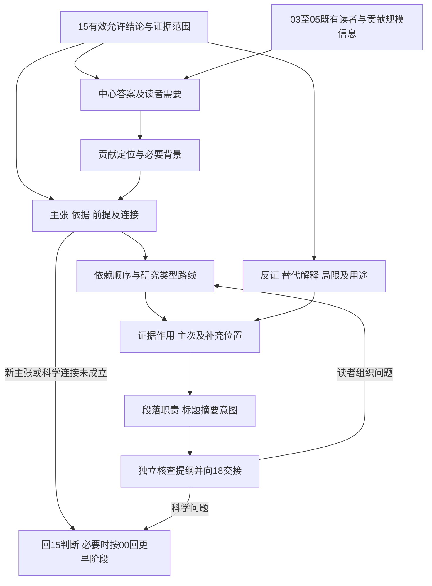

# 科研叙事阶段详细手册

本阶段把15允许的结论与依据组织成可读、可核查的论证提纲，也支持从零散材料、旧稿和读者反馈进入。

## 本阶段形成什么，承接什么

中心问题是：**在15允许表达的范围内，怎样让读者看清研究回答了什么、为什么能这样回答、答案的价值及边界？**“故事”在此指论证组织。研究可以得到反证、未定结果、条件混合或很小的应用贡献，不需要编成重大突破、预期胜利或英雄经历。

职责按[当前完整流程](../docs/workflow-design.md)划分：14分析结果，15判断证据允许相信什么，16决定论证重点和阅读顺序，18将提纲写成稿件并制作具体图表、公式、引用与补充材料。17的期刊表达准备属于18内部；16只复用03—05既有的读者、文章类型和贡献规模信息，不再选刊、校准预算或编写期刊样式。

进入本阶段时，AI读取有效的研究问题与原预期、原预期形成时间，以及14／15同一结果记录中的增量：逐主张的支持／反驳／未定／条件混合判断及理由，支持和不利证据原链接与前提，最强竞争解释及未排除之处，允许结论句及对象、条件、不确定性、验证或探索身份，不可表达的升级，以及决定当前主张的缺口和去向。这里描述需要承接的信息，不强制上游采用新字段、表格或注册系统。

缺少哪项，只补与当前论证有关的最小信息。没有允许结论时，可以整理读者与材料关系，但不能自定中心结论。不能用更有吸引力的措辞越过15，不能从结果倒造原假说，不能以编排需要追加研究。共用任务、独立验收、回退和交接继续采用[00规则](../00-阶段交接关系/阶段交接关系.md)。

通常新增一份带证据链接的论证提纲即可，放在实际项目指定的稿件或研究记录位置；同一证据及科学判断仍引用其权威记录。本元研究把解决方法、来源与待适配项集中在本页，不预先替所有真实项目创建文件。

## 先找到读者应带走的答案

### 1. 从允许结论出发，明确中心问题与阅读目标

科研人员容易把“做了哪些工作”当成论文主线，读者却首先要知道研究问题和所得答案。AI先把已确认问题与15的结论并置，解释二者是否对应：全部回答、部分回答、对原预期提供反证，还是目前仍无法分辨。答案可以是“在此范围内未得到预期支持”，但其确切措辞仍由15提供。

AI可以展示一至两个**同样受证据约束**的组织候选，例如先强调适用条件，再强调实际用途；说明各自让哪类读者更容易理解。用户不知道该突出什么时，AI用已有材料演示候选的读者收益和代价，不要求用户先给出漂亮故事。先解释一个影响主线的差别，再根据反馈继续，不把全页问题一次性变成问卷。

核查时把中心答案拆回15的允许句，检查是否悄悄增加了对象范围、因果身份、可靠程度或应用承诺。复合答案允许多面贡献，但各部分必须围绕同一问题，且证据身份清楚。没有足够证据的吸引人解释留在未决事项；不能为了让主线完整把它填成事实。本阶段够用的尺度是另一位读者能复述“问题—有限答案—关键理由”，不要求一句话容纳所有结果。

### 2. 识别实际读者及其必要前提

从03已确认期刊、文章类型和05校准信息提取主要读者，而非凭“高水平论文”预设所有读者。专业读者可能关心比较是否公平、对象与既有研究是否一致；应用读者可能关心收益与代价在哪些条件成立；跨领域读者可能首先缺少概念定义。不能为了广泛可读删掉支撑判断的技术前提。

AI说明三个层次：读者为什么需要这个答案，读者已经知道什么，读者进入证据前必须知道什么。先从已有指南和相关原文得出合理初稿，用户没有读者经验时给出短的解释和取舍。未知术语先用一句可核查的定义说明；没有权威定义或多种定义并存时，在提纲注明采用的意义及理由，不随意合并。

具体做法是对每个核心论证节点询问“读者此时凭什么理解它”。将必要定义、对象说明、比较条件或材料语境放在首次依赖前；把深入技术展开交给方法、附录或18。若需要大量背景才能理解一个次要分支，考虑移出主线，不能反过来扩大引言。读者分析只需足以决定主线和解释负担，不另建人格画像或市场调查。

### 3. 说清贡献类型、大小与已有工作的关系

“价值”不等于“前所未有”。贡献可为局部改善、边界条件、可重复的反证、资源或测量的可用性、概念澄清、档案再解释、质性理解、证据整合，或者在受限环境中的适用经验。AI先依据15和既有05校准，说明本研究改变了哪个可判断的知识或实践问题，再组织其定位。

定位时至少区分三件事：已有工作做到哪里，本研究在相同或不同条件下增加了什么，这一增加为什么有用。跨数据集、样本、理论范围或时期的比较不能直接写成优越性。若“首次”“普遍”“取代”“突破”“最优”等词承担中心贡献，须有相应证据与适当检索；检索没有找到不自动证明没人做过。没有查清时用可核查的具体差别表达，不继续提高创新强度。

AI从01—06已有文献中挑最接近而不只是最有名的工作，打开其原文核对对象、方法、结论及限制。若只差一个关键定位来源，先解决；若补查会变成新系统综述，标明边界并缩小定位。期刊预期高于实际贡献时，16保留实际贡献并把失配交回03／05处理，不能靠叙事补足证据。本阶段不要求所有小研究进行全面创新性排名。

以上三点借鉴[Mensh与Kording的结构指南](https://journals.plos.org/ploscompbiol/article?id=10.1371/journal.pcbi.1005619)关于中心贡献与读者的思路；本流程将贡献强度限制在15，并将读者适配与原先科研决策区分。该指南的“一个中心贡献”是组织启发，不是要求拆掉合理的多面研究。

## 把答案展开成可以检查的论证

### 4. 区分主张、依据与连接二者的理由

只有“结论＋几张图”往往不够。AI把中心答案分解为必要的中间判断，逐一说明：引用哪项结果或材料，为什么它对当前问题有关，从该依据走到中间判断需要哪些前提，怎样再走到中心答案。连接理由可能来自方法有效性、对照逻辑、定义、推导或材料解释，不能用引用数量替代。

不必造一个复杂论证系统。可以在同一提纲中用短句和链接表达“读者问题→允许判断→关键依据→必要前提→下一步”。已有主张编号或证据索引直接复用，没有编号时用稳定位置引用。每条连接都能用普通语言解释“因为……在……前提下，所以……”，不把结论重新写一遍充当原因。

核查容易出现的跳跃：观察到结果就认定唯一机制；方法在一个条件有效就说处处有效；一部分案例就覆盖总体；理论设定里已含结论；两个竞争解释之外还有未讨论的解释。发现跳跃时，16先定位是哪条连接失效，把更强表达或新解释回15判断；需要新分析或取证时按00返回相应上游。重新排序只能解决读者看不见的已有前提，不能创造前提。[概念文章方法论文](https://link.springer.com/article/10.1007/s13162-020-00161-0)与[科学逻辑谬误模块](https://github.com/K-Dense-AI/scientific-agent-skills/blob/main/skills/scientific-critical-thinking/references/logical_fallacies.md)为此提供参考；后者用来发现推理问题，不替代15的科学裁决。

### 5. 找到依赖顺序，再决定叙述顺序

先找逻辑依赖：证据能被理解前是否要知道样本与对象、测量可信范围、假设、比较条件或材料语境？对该研究必要的前提安排在被使用之前。彼此独立的证据可以并排组织，串联推理则不能任意交换。不是所有研究都要先展示“方法有效”；已有有效检查可简短引用，避免把12、14、15整段重新执行。

再比较两种读者路线：按问题／论证步骤推进，或按条件／对象／时间组织。选取能减少跳转、保留前提、显露分歧的一种；相似问题采用相近层次，相关依据放在一起。时间顺序在过程、历史和变化研究中可能本来就是论证的一部分，不能一概删除。

实际开展研究的时间与读者阅读顺序分开记录。可以把先做的工作后讲，把必要定义先讲；仍须在方法与有关结果中忠实交代原计划、探索或事后变化。不能把“为了阅读流畅的下一步”改写成“事先按假说实施的下一步”。AI向用户解释这里调整的是阅读顺序，原预期及分析身份沿用15。

够用时可以只写一段排序理由；存在复杂串联和分支时，再画简单节点图。不能以“线性故事”为由删去真实的多种条件和未定分支。[结构指南](https://journals.plos.org/ploscompbiol/article?id=10.1371/journal.pcbi.1005619)把读者逻辑与研究经历区分，本流程另外保留计划及分析身份的上游引用。

### 6. 为每项依据指定论证作用，避免证据堆砌

AI从已有记录标明关键材料在论证中做什么：直接回答问题、支持前提、比较解释、检验稳健范围、展示边界，还是提供背景。某项结果很漂亮但不能推进中心答案时，不自动成为主结果。相反，难看的反证若决定主张边界，就不能当作装饰性附录。

每项核心论点旁保留最直接依据的定位、适用前提及不确定性说明。多项依据同时存在时说明是互补、独立支持、相互依赖还是冲突；同一样本、同一底层数据或同一档案的多个呈现不能在叙事上算作多次独立验证。依据本身的可靠性复用14／15判断，不在16重新打分。

涉及图、表、推导、引文或案例时，16只记录它要回答的读者问题、承载的允许判断和源材料位置。例如“需要展示整体收益与代价的关系”，不是先选某种图形再找数据；“需要给出从假设到命题的推理链”，不是预先规定公式数量。18决定具体展示、制作、尺寸、符号、图注、期刊位置和格式。本阶段可以用文字代替展示建议，只要核心论证可读、可核查。

这一做法吸收[scientific-writing的证据提纲工作流](https://github.com/K-Dense-AI/scientific-agent-skills/blob/main/skills/scientific-writing/SKILL.md)及[证据来源模块](https://github.com/K-Dense-AI/scientific-agent-skills/blob/main/skills/scientific-writing/references/evidence_workflow.md)，但不导入其五种注册文件、哈希流程或脚手架命令。项目复用已有权威记录，提纲只添加组织增量。

### 7. 让反证、负结果与竞争解释进入主线

先继承15对反证、未定结果和竞争解释的科学判断，AI说明它们改变了哪个中心判断、边界或用途。有的研究主线就是可靠反证或条件差异；有的负结果只限制了次要解释。不能把不显著改成等效，不能把没有观察到现象改成现象不存在，不能把反驳一个解释改成证明另一个解释。

安排材料时遵循影响：决定中心答案的反证与必要限制在主论证附近出现；大量细节可放补充材料，但正文应明确其存在及对主张的后果。多个条件得到不同结果时，以条件作为组织轴或并列说明，不选一个条件代表全部。失败且不影响当前结论的操作经历可留在研究记录，避免把每次操作都写成论文情节；影响测量、样本、解释或可重复性的失败仍需适当报告。

用户希望主线更“正面”时，AI解释可以突出可信的小贡献，但不能削弱不利证据。用户不知道怎样解释反证时，AI展示15已有的候选解释与未排除处，先组织已允许说法；不能替用户挑最悦耳的机制。若15尚未给出反证后允许说到哪里，这项未知先解，再写对应节点。[scientific-writing原则](https://github.com/K-Dense-AI/scientific-agent-skills/blob/main/skills/scientific-writing/references/writing_principles.md)与[scientific-critical-thinking](https://github.com/K-Dense-AI/scientific-agent-skills/blob/main/skills/scientific-critical-thinking/SKILL.md)共同提示保持不同结果身份和表达范围。

### 8. 取舍正文、方法与补充材料，同时保证完整性

AI依次判断材料是否对中心答案必要、是否是报告规范要求、是否有明确补充用途。必要内容在读者依赖处保留可理解的概述；完整方法、全部适用结果及深入推导按文章类型和04既有要求安排。移动到补充材料只改变位置，不能减少必要报告，也不能使主文独立看时得出更强结论。

可做一个纸面“暂时移走”检查：只在提纲里假设某节点移出，读者能否仍判断主论点？若主论点因此失去前提或遗漏关键反例，就留下概述和明确链接。此检查不实际删除数据、旧稿、证据或文件。重复解释合并到一个负责的位置，其他段落短引用；同一事实在不同部分的简要复述可以有不同沟通用途，但保持同一出处和含义。

与正文无关的新问题可以留为未来研究，不能为了展示工作量强塞进论文。小论文够用时不建复杂附录体系；篇幅紧张时先减少无关铺垫和重复，再考虑可移动细节。是否分成多篇、改文章类型或换刊会改变科研与发表决策，16提出具体影响，返回相应位置处理。

## 按研究的实际论证方式组织

### 9. 选择适合研究类型的主线，不强制发现型故事

下表是组织路线的候选，不是阶段任务清单。AI先从已有设计、证据与15判断识别路线，必要时解释两种可行组织的取舍；不用要求用户掌握方法术语。混合研究可以共用一个问题而保留不同材料的证据身份，不把所有路线强塞进同一稿件。

| 路线 | 可能的组织骨架及具体检查 | 够用尺度与后移事项 |
|---|---|---|
| 原假说检验、反证或未定结论 | 原问题与预期→必要设计／测量前提→对应证据→原预期判断→未排除解释／范围。将主要结果、探索结果和反证分别标清；不是“最后必须支持假说”。 | 读者能看出为何得出当前判断。新的检验假说回02或15，新增取证按00处理。 |
| 方法、小应用或资源贡献 | 实际需求与使用条件→现有可比办法／资源→本方案的具体作用→既有验证证据→收益、代价、失败条件和可用边界。局部价值可以成立，不自动宣称普遍优越。 | 范围明确且使用者能判断何时值得采用即可；制作教程、代码发布和实现细节分别回有关阶段。 |
| 描述、复现与边界条件 | 为什么需要这项描述／复现→原研究或既有认识与本次条件→相同／不同／未定结果→允许解释→适用边界。核对比较条件是否足以支撑“复现”身份。 | 能区分可靠信息与仍待验证部分；不要求再造新机制或显著改进。 |
| 理论、形式推导或数学证明 | 对象与问题→定义／假设→关键命题及依赖→证明或推导依据→解释、特例／反例和适用域。顺序可由命题依赖决定。 | 关键论证链清楚、条件随命题传递；16不新证命题或补造定理，完整公式与证明编写交18，正确性问题回有关上游。 |
| 概念澄清、理论整合／调整、分类或模型 | 指定概念难点→已选理论／概念及各自作用→比较、拆解或连接步骤→允许的新框架／命题→例证、边界及仍待经验检验部分。定义变化与论证前提显式交代。 | 能看见概念如何变化及为何这样连接。引用不是装饰，框架图不是已证因果；四种概念设计是参考而非完备分类。见[Jaakkola原文](https://link.springer.com/article/10.1007/s13162-020-00161-0)。 |
| 质性、案例、解释与过程研究 | 问题及语境→分析立场与必要方法说明→主题／类别／案例关系或过程→材料与分析连接→差异和反例→解释、可迁移范围。引文、田野笔记或片段保留足够语境，不能用精彩引语代替分析发现。 | 读者能跟随材料到解释的过程；不强制样本频率、因果验证或统一编码检验。按自身方法传统核查，展示方式可合并发现与讨论。见[APA JARS–Qual表1第3—4页](https://apastyle.apa.org/jars/qual-table-1.pdf)。 |
| 历史、档案或文献解释研究 | 问题及既有解释→来源形成语境及选择范围→时间／主题／比较证据→解释连接→冲突、沉默与局限→对既有解释的调整。时间线可能本身就是必要结构。 | 查明谁在何时为何对谁形成材料，区分史料表述与研究者解释；不能拿一份材料覆盖全部时期或群体，也不把档案缺失直接当作事件未发生。见[Harvard来源与证据指南](https://history.fas.harvard.edu/resource/sourcesandevidencepdf)。 |
| 系统证据综合或范围综述 | 综合问题→纳入与比较范围的必要说明→按问题组织的研究特征与结果→一致／分歧及确定性→总体答案、证据局限与综合过程局限。不是把单篇论文摘要串成主线。 | 依据真实综合方式保留局限；不将质量异质、不可合并或描述性结果写成统一因果答案。按类型复用上游规范，PRISMA 2020以干预效果系统综述为主要适用对象，范围综述另有扩展。见[PRISMA官网](https://www.prisma-statement.org/)及[扩展清单第8—9页](https://www.prisma-statement.org/s/PRISMA_2020_expanded_checklist-yc78.pdf)。 |

上述顺序可以调整；论证前提及证据身份不能丢失。没有找到覆盖这些路线每个细点的专用Skill，本页用方法论文与官方学术指南补足。报告指南只帮助发现应该交代的内容，清单齐全不自动证明科学结论成立。

### 10. 建立背景、缺口与本研究的准确对话

从已有01、02、06文献复用背景，先解决“读者为什么需要当前答案”。可按“相关的已知→具体未定或困难→其影响→本研究在该范围内能回答什么”组织。不一定是“没有人研究”：已有解释冲突、概念混用、条件变化、测量限制、迁移未知或档案重新解释，都可以成为合理入口。

AI为每段背景指定一个作用，检查删去它是否影响中心问题的理解。泛泛的领域重要性、技术发展史和无关文献堆积通常不能推进具体问题。对已有工作按其真实主张呈现，最强相关解释也应公平说明，不能先弱化前人再宣称自己解决。

检索操作先复用已有来源，再用关键概念及最接近论文的引文查找缺口的限定范围。打开原论文的目标、对象和讨论，确认“未解决”究竟指什么。已知文献不足时先补关键处；需要完整新综述时按研究规模判断是否回06或缩小背景断言。不能为迎合最终结果把原先预期改成必然正确的研究问题；探索所得问题可以清楚标明其形成身份。

够用时，背景只支撑此论文要回答的范围；不要求重写全领域知识。自然科学文章的常见背景收束可以借鉴[Nature摘要段指南](https://www.nature.com/documents/nature-summary-paragraph.pdf)，其广泛读者和句数安排不移植为所有类型论文的硬规则。

### 11. 组织讨论的解释、局限与用途

讨论不是重复结果，也不是从局部结果扩大到宏大愿景。AI承接15，将讨论节点安排成当前答案的含义、与相关已有解释的关系、最重要限制及实际可用之处。可以有多种合理解释，也可以最终保持未定；不能靠段落结尾的强语气关闭科学未知。

每项局限说清影响哪个主张、可能造成什么后果、已被何种现有证据缓解，以及仍不能排除什么。只是“样本较小”“未来再研究”而无影响说明通常不够；但没有依据时不能编造偏差方向。既有15给出的判断先用，不要求所有局限都新增实验。核心解释的限制在有关论证处先提示，讨论再集中说明。

用途按证据阶梯区分：已在范围内展示的用途、合理但尚待检验的用途、不能由本研究支持的行动承诺。小应用可以清楚说解决哪个局部需求；概念研究可指向待检验命题或理解方式；质性研究提供语境丰富的可迁移理解而非自动总体估计；证据综合区分原研究证据局限和综合过程局限。新用途若等于新增科学主张，先回15，不只留给18润色。

每个未来工作方向应接到一个实际未知或限制。足够用时提出最有必要的去向，不必列长愿望表。[IMRAD与一致性模块](https://github.com/K-Dense-AI/scientific-agent-skills/blob/main/skills/scientific-writing/references/imrad_structure.md)、[JARS–Qual](https://apastyle.apa.org/jars/qual-table-1.pdf)及[PRISMA扩展清单](https://www.prisma-statement.org/s/PRISMA_2020_expanded_checklist-yc78.pdf)支持不同路线的讨论要求；具体科学判断仍在15。

## 让提纲可以交给写作者

### 12. 把组织逻辑落为段落职责与展示意图

先写每节要解决的读者问题，再给必要段落一条职责句：该段提出什么、引用什么、为下一段留下什么。不预写漂亮正文，也不要求每段套相同句数或“背景—内容—结论”格式。一个短论点可以只需一个段落，复杂概念或质性主题可能需要多个段落。

交给18时，提纲足以让写作者知道每项判断的证据位置、概念含义、表达边界与顺序理由。证据来源缺失不能用“待补图”“待补引用”掩盖；区分真正待核的依据与18才能决定的图形、版式、符号、措辞和长度。期刊不允许结论式小标题时，论点句仍可作为内部提纲，18再转换标题形式。

核查每段是否承担实际工作、主线是否来回跳转、相似材料是否采用能比较的层次、同一概念是否悄悄换义。未形成主线时先改组织，不在细句润色上投入。已有稿件的有效段落可复用，只重查受新提纲影响的部分；不要求把所有内容推倒重写。

### 13. 用标题和摘要意图核对“承诺—答案”一致

16可以给出标题要准确传达的贡献与对象范围，以及摘要应让读者看到的问题、方法身份、关键答案和边界。这是表达意图，不是最终标题、摘要或固定句数。18依据完成的主文、04格式和17期刊表达建议写出并核对成稿。

AI把暂定标题意图与中心答案相对照：标题是否宣称证实因果、普遍适用或首次突破，而正文只允许有限关联、单条件使用或局部解释？摘要若独立阅读，是否能看见决定判断的不确定性或负结果？背景承诺的缺口是否比实际回答更大？若存在差距，先缩小承诺或回15核查，不能把更强标题当成改写科学结论的目标。

可尝试两种同等准确的标题取向：问题／对象取向或已允许答案取向；无必要不造候选数量要求。用户不懂标题风格时先解释两者的读者信息差别，最终具体措辞后移18。Nature官方PDF是特定刊物的摘要段说明，本页只借鉴其“问题、结果与知识增量对齐”的用途，不照搬“here we show”、句数或字数。

### 14. 做陌生读者检查，并区分理解问题与科学问题

给独立验收者足以理解提纲的最小背景、提纲及允许结论／证据引用，不只给漂亮摘要。让其在未获作者口头补充的情况下回答：研究要回答什么，实际增加了什么，核心结论依赖什么，最重要反例／限制是什么，哪些地方仍不知道，下一位写作者应怎样继续。问题按提纲实际复杂度选择，不强制固定数量。

读者漏掉已有前提或找不到相关证据，是组织问题；读者指出证据无法支撑连接，是科学问题，应回15或更早阶段；读者只是不喜欢结果方向，不构成否定论证的理由。检查误读是否来自词义、顺序、过多分支、背景不足、主次不清或标题承诺，再修受影响部分。

[Anthropic doc-coauthoring](https://github.com/anthropics/skills/blob/main/skills/doc-coauthoring/SKILL.md)的陌生读者测试可帮助发现作者默认知识，本流程只吸收该方法。它面向文档、提案和规格，不是专用学术论证Skill；不引入固定的5—10个问题、5—20个候选，也不让文档问答正确代替科学审查。模拟读者或AI通过检查不等于真实读者可用性或19审稿通过。

## 未知先后、节点关系与实际任务选择

决定中心答案或其含义的未知先解：允许结论缺失、原预期身份不清、关键证据无定位、定义或比较条件歧义、反证影响未裁决、核心连接需新增解释。AI把未知指到最早负责的位置，说明它影响哪段；未依赖它的组织工作可继续。

标题具体词句、摘要成稿、图表类型和制作、公式版式、期刊段落长度、引用风格、补充材料成稿后移18／17。没有被证明的新机制、额外用途或更大推广范围不是“写作稍后补”，而是科学未决。背景定位补查只解决必要来源，不能偷偷变成新的实证研究或系统综述。

图的连线表示传递的信息，不把每个框变成任务或新文件。实际任务按当前研究缺口生成，仍采用00每次发布一项、独立验收后调整的循环。可以只选以下子图：

- **小应用提纲已经基本清楚**：15范围→读者实际需要→收益与代价的论证→边界和关键依据→段落职责→交18。背景够用则不重写综述，已有有效贡献校准直接复用。
- **反证或条件混合结果**：15判断与不可升级表达→相应中心答案→原预期及条件组织→关键反证和替代解释→讨论范围→交18。不能以故事不够成功为理由重新取证。
- **概念、质性或档案研究**：15允许解释→概念／来源语境→本路线的分析连接→差异、反例或材料沉默→贡献与适用边界→读者核查。没有独立量化检验的路线不强制补统计图。
- **证据不足以连成中心论证**：定位缺失前提或表达升级→回15澄清或缩主张→复用仍有效节点。确需新分析、方法或取证时按00处理授权与上游，不用先写一套完整故事等待证据填空。

这些是元研究的选择示例，没有替真实课题预设结论、提纲或固定小阶段任务表。

## 完成尺度、交接与失败处理

本阶段完成时，接收者能从同一提纲及其链接找到：中心问题与允许答案、主要读者与实际贡献、必要背景与定义、论证步骤及前提、各项关键支持与不利依据的作用、研究类型与排序理由、主次及补充位置、讨论边界，以及交给18的段落与展示意图。已有信息只引用，不复制一份结论记录。

独立验收重点检查：

1. 中心论点、各节点和标题摘要意图没有超过15；原预期、探索身份和实际历史未被改写。
2. 读者能沿现有依据与前提走到答案，串联／并行关系清楚，关键定位可打开。
3. 反证、条件差异、替代解释和不确定性没有在重排或移到补充后失去科学作用。
4. 贡献定位可核查且与实际规模相称，研究路线适合自身方法，不强求重大创新、统计证据或统一结构。
5. 18接收后可继续具体写作；决定论证的未知有明确处理去向，没有用编排或占位内容冒充解决。

提纲不存在组织问题即可交接，不另设16用户最终确认关口。用户可继续反馈表达重点；若反馈要求改变选题、核心假说、目标期刊或实质研究方案，按00已有关口处理。19独立科学审查仍在稿件完成后开展，16的验收不能代替它。

无法形成完整中心论证时，保留受证据支撑的有限贡献和失效连接，按影响回15缩主张、澄清或停止；确需补证则按00返回上游。改变结论、概念定义、证据或定位后，只重查依赖部分及受影响提纲，不无条件重做全文。仅变更图形风格或文字长度时，由18核对含义是否变化即可。

## 来源、网站操作与适配边界

本轮使用在线资料作研究来源，未把外部Skill设为本流程运行指令，未安装或执行其脚本、脚手架、模型调用和发布流程。访问日期均为2026-10-14；GitHub `main`可能变化，版本写为本次正文所见，不把本次学习说成工具验证。以下来源与操作集中在本页，避免另建阅读缓存或重复清单。

| 实际阅读来源 | 阅读内容及本页借鉴 | 复查或未来使用时的具体网站操作与限制 |
|---|---|---|
| [K-Dense scientific-writing SKILL.md](https://github.com/K-Dense-AI/scientific-agent-skills/blob/main/skills/scientific-writing/SKILL.md)，正文版本2.3，last-reviewed 2026-10-01 | 实际阅读全文，重点为证据提纲、结果身份、完整报告和适用结构；配套实际阅读[证据工作流](https://github.com/K-Dense-AI/scientific-agent-skills/blob/main/skills/scientific-writing/references/evidence_workflow.md)、[IMRAD结构](https://github.com/K-Dense-AI/scientific-agent-skills/blob/main/skills/scientific-writing/references/imrad_structure.md)和[写作原则](https://github.com/K-Dense-AI/scientific-agent-skills/blob/main/skills/scientific-writing/references/writing_principles.md)。支撑第1、6—8、11—13点。 | 进入对应技能目录，打开SKILL.md的Raw正文，定位“Create an evidence outline”，再只开有关references；核对正文metadata版本。复用证据绑定思路，不导入该库文件协议、政策断言或强制人工状态规则；本流程共用规则以00为准。未读无关模块，不宣称完整验证其全部功能。 |
| [K-Dense scientific-critical-thinking SKILL.md](https://github.com/K-Dense-AI/scientific-agent-skills/blob/main/skills/scientific-critical-thinking/SKILL.md)，正文版本1.5，last-reviewed 2026-10-01；[logical_fallacies.md](https://github.com/K-Dense-AI/scientific-agent-skills/blob/main/skills/scientific-critical-thinking/references/logical_fallacies.md) | 实际阅读全文及逻辑谬误模块，关注隐藏前提、循环论证、选择依据、过度推广、先射箭后画靶与证据身份。支撑第4、7点。 | 从SKILL中的References开模块，围绕具体推理连接查找相应问题；不得只凭一个谬误标签宣布结论错误。本阶段未应用GRADE、RoB或任何证据评分，没有重新执行15评价。 |
| [Anthropic官方skills目录](https://github.com/anthropics/skills/tree/main/skills)及[doc-coauthoring正文](https://github.com/anthropics/skills/blob/main/skills/doc-coauthoring/SKILL.md) | 核对官方目录并阅读全文。目前未发现专用academic/scientific-writing项；doc-coauthoring是通用文档共写，借鉴按未知展开与陌生读者测试，主要支撑第14点。 | 官方仓库目录核对名称，打开正文后定位Stage 3 Reader Testing。不要把社区自称“Anthropic学术写作Skill”的材料视为官方；不把通用工作流的固定问卷或反复确认搬进本阶段。正文无版本元数据，本次记录为访问日。 |
| [Mensh B, Kording K. Ten simple rules for structuring papers，2017](https://journals.plos.org/ploscompbiol/article?id=10.1371/journal.pcbi.1005619)，DOI 10.1371/journal.pcbi.1005619；[2017更正](https://journals.plos.org/ploscompbiol/article?id=10.1371/journal.pcbi.1005830) | 实际阅读原论文规则1—10及更正。借鉴中心贡献、读者逻辑、提纲与反馈；更正针对图1缺少图例。支撑读者组织和第5、12点。 | PLOS页面检查作者、发表日期与Correction入口，再阅读正文，若使用结构图则看更正版。其C-C-C及中心贡献是启发式，不作为所有研究、段落和期刊的固定结构；本页未复制原图或原文。 |
| [Nature官方摘要段说明](https://www.nature.com/documents/nature-summary-paragraph.pdf)，PDF标为Nature guide to authors September 2019 | 实际读一页官方PDF，学习基本背景、具体问题、主要结果、知识增量与更广语境的连接。支撑第10、13点。 | 从nature.com官方域打开PDF，检查文件标注时间；真实写作时先复用04已核的当前指南，再确认这份旧PDF仍适用。未据它宣称当前字数或格式要求，不把示例和句数复制为全领域规范。 |
| [Jaakkola E. Designing conceptual articles: four approaches，2020](https://link.springer.com/article/10.1007/s13162-020-00161-0)，AMS Review 10:18–26 | 实际阅读全文，重点为选用理论的理由与作用、可见论证链以及理论整合、调整、分类、模型四条路线。支撑第4、9点的概念路线。 | Springer原文页查看Abstract后阅读“methodological requirements”和四类设计，再核结论及DOI；表格可帮助对照具体路线。原论文以营销领域概念研究为背景，不能宣称分类完备，也不能把概念框架当作已经验验证的因果模型。 |
| [APA JARS–Qual官方入口](https://apastyle.apa.org/jars/qualitative)与[表1 PDF](https://apastyle.apa.org/jars/qual-table-1.pdf)，表标©2024 APA | 实际阅读入口和表1第3—4页的分析、方法完整性、发现与讨论，以及相关语境和可迁移说明。支撑第9、11点；引文要支持分析而不代替分析，反证与方法传统须保留。 | 从官方入口点Qualitative Design Reporting Standards，读Findings/Results及Discussion，回看本研究方法对应的分析要求。按研究传统选用，表中辅助检查不是全部必做项目；心理学指南跨领域使用需说明适配。 |
| [PRISMA官网](https://www.prisma-statement.org/)及[PRISMA 2020 expanded checklist](https://www.prisma-statement.org/s/PRISMA_2020_expanded_checklist-yc78.pdf) | 实际阅读官网适用说明、扩展清单中的结果综合、确定性和讨论条目，重点为证据局限与综合过程局限的区分。支撑第9、11点的综合路线。 | 在官网按真实综合类型进入2020或Extensions，开Expanded checklist，定位20—23条，复用上游适用规范；未据条目齐全认定综合结论可靠，未对真实论文打合规分数。 |
| [Harvard History: Writing a History Paper—Selecting Sources and Presenting Evidence](https://history.fas.harvard.edu/resource/sourcesandevidencepdf)，Kristin Poling，2008/2009 | 实际读一页PDF，学习来源语境、材料适配与公平解释，支撑第9点档案路线。 | 从历史系原网页打开PDF，核作者和日期，按来源形成者、目的、读者、解释语境逐项对照已有15判断。它是学科教学指南，不是所有档案研究的审稿标准；不把它代替史料真伪及来源可靠性审查。 |

补充检索边界：本轮查到[EQUATOR的SRQR入口](https://www.equator-network.org/reporting-guidelines/srqr/)，确认2014指南和补充材料链接；原出版社旧链接转到新平台首页、补充链接未成功取得正文，因此没有把SRQR全文列作已读方法依据，相关具体组织改用已取得的JARS–Qual官方表。另查到[2024概念叙事社论](https://link.springer.com/article/10.1007/s13162-024-00292-8)，页面只有订阅内容预览，未读全文，不采用其会议室隐喻或流程图作依据。检索障碍未导致本阶段必须停下，已有开放原文足以研究相应组织问题。

## 后续具体课题才决定的内容

真实项目的中心论点、贡献大小、研究类型组合、原问题得到回答的程度、证据位置及取舍、段落数量和论证图都要从其15记录产生。本轮没有编造这些内容。目标读者和期刊限制先复用03—05／04，只有变化时才补查；没有共同固定的篇幅、图数、参考文献数、问题数或必须得到的结果方向。

尚需在真实使用中检查的是各学科对证据、概念、材料语境与叙述形式的习惯，以及目标期刊当前文章类型要求。本页给出跨类型的处理方法和具体核查，不声称覆盖所有学科的全部论证传统；后续遇到未覆盖路线时补最相关方法来源和必要节点，仍写回本页，不创建另一个通用故事模板。

## 从零散材料、旧稿与读者反馈形成可用提纲

### 先取得足以组织本次内容的输入

用户可能带着结果表、几页证明、材料摘录，或一份已经写了很多的旧稿来。AI先读这些实际内容，概括现有答案、证据和疑问，说明本次是建立主线、调整顺序，还是压缩已有结构。没有正式15记录时，可以把当前稿件中的主张与依据对应起来；尚未核查的科学连接保持待判断身份，不要求用户先补完整上游文件再提供组织帮助。

先为最核心的一项读者问题提出可理解的答案和支持范围。如果材料支持几种组织，展示有实际差别的短方案并推荐其一，例如“按问题依赖推进更容易看清理由”或“按时期组织才能保留变化证据”。普通排序可自主完成第一版，用户不必先选学术叙事术语；方案如果要求新科学结论，先回15判断。

### 杂乱结果怎样变成第一版论证

1. **辨认材料身份。**分清实际结果、主张、背景、方法依据、失败、反例和未验证想法；同一底层证据的几种呈现先合并认识，不当作多项独立贡献。
2. **先写有限答案。**用当前允许判断回答研究问题；只回答一部分时明确这部分。没有中心答案可先组织资料与缺口，不能为了完整写出成功结论。
3. **给依据分配作用。**对核心材料说明它直接回答什么、支撑哪个前提、限制哪种解释或揭示什么边界；不能仅因工作费时就放主线。
4. **安排读者必须知道的前提。**定义、比较条件、来源语境在被依赖前出现，再排列并行或串联依据。每个拟用展示先写其读者问题和依据位置，具体制作交18。
5. **试读并压缩。**只看职责句，判断能否从问题走到有限答案。重复作用合并，无关分支移出主线；决定结论的限制和反证必须在依赖处可见。

构造例：已有材料分别显示某场景用时减少、精度比较仍有不确定性、另一场景实施失败。可形成“限定条件下的效率收益与代价边界”主线，先说明实际需求与可比条件，再将用时、精度未知和失败范围放在相应判断附近。另一条合法路线是按两个场景并列，让读者先看适用条件差异。选择取决于中心问题及证据作用，不能把不确定精度写成“精度不变”，也不能移走失败后宣称普遍可用。一个窄效率贡献可以成立，但其是否满足实际用途仍由15判断。

理论稿先依定义／引理组织主要命题，局部反例可成为中心答案；质性稿按解释问题组织材料和异例，不按每份访谈逐个摘要；档案稿保留影响判断的时间与来源关系；综述按所回答问题整合研究，不按文献发表顺序罗列。这些是选法，不要求每篇都有上述所有分支。

### 已有稿件怎样做反向提纲

先读取现稿，按实际段落用简短话概括“写了什么”和“对整体论证起什么作用”，保留现有位置，暂不逐句润色。再看主张是否有依据、前提是否先出现、同一作用是否被不同章节重复承担、读者是否被无关分支反复打断。已有提纲不能代替这一步，因为现稿可能已经偏离原计划。

据此只改需要的组织：两个段落同做铺垫可合并；一个段落混有定义和新结果可按作用拆开；条件晚于结论则前移必要说明；论证缺证据应回15或相关来源，不能靠移段落填补。核心材料移补充前，再作第8点的暂时移走检查；决定结论的反例不能只因打断“顺畅故事”移走。

构造的旧稿顺序“宏观背景—结果甲—另一段宏观背景—概念定义—结果乙”若甲乙都依赖该概念，可先合并有关背景、定义概念，再按二者关系组织甲乙。但概念定义若本身是论证所得的新结果，就不能无条件前移成既知事实，须先交代其形成身份。修订记录留在当前提纲／稿件既有位置，不为每段另建文件。

此方法参考[Purdue OWL反向提纲](https://owl.purdue.edu/owl/general_writing/the_writing_process/reverse_outlining.html)的段落内容与论证作用辨认；这里只借方法，不复制其边注格式、固定词数或把一般写作练习当科学正确性验证。

### 把反馈变成一次有对象的修改

先确认用户指的实际版本和位置，再把“看不懂”“重点不突出”等反馈转成能检查的原因。原内容有效的保留，只修改受影响节点；不要每次另给一份全文或新故事。

| 当前反馈／读者表现 | 优先核查并修改什么 |
|---|---|
| 能复述结果，却说不清研究增加什么 | 检查中心问题、近邻对话和贡献句是否对应；若实际增量未确定，回15／贡献依据，不只加形容词 |
| 看到结果时不知道对象或概念 | 将必要对象、定义、比较条件／材料语境放在首次依赖前，删去无作用的背景 |
| 觉得来回跳、两节像在重复 | 用反向提纲检查主题和职责，将相关依据相邻组织，复用同一事实而非再解释一遍 |
| 忽略了限定或把相关读成因果 | 在核心判断附近保留限定，并核查标题／提纲是否暗示升级；推断本身有问题回15 |
| 认为负结果使故事失败 | 说明它改变了什么答案或边界，保留信息价值；不追加研究去制造正面结局 |
| 提出一种现证据不能支撑的新解释 | 单列其科学未知，回15决定；不让写作者在过渡句中补成事实 |

修改后用短提纲再次解释问题、有限答案、关键依据和限制；检查原误读是否消除，有无新增矛盾，再交18。独立读者可帮助发现默认知识和连接缺失，但AI问答通过不能证明学术论证成立，也不要求用户逐节点批准。

