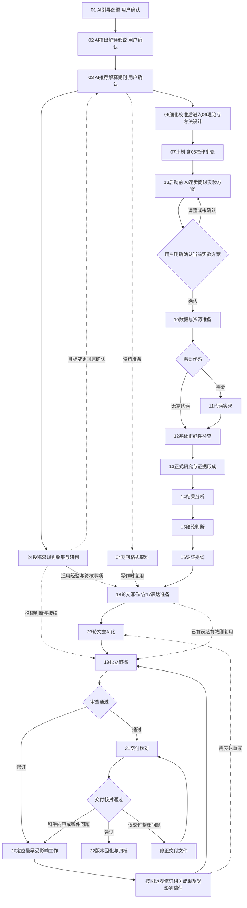

# 完整科研流程

本流程按15条主线组织，24个资料编号用于定位，加00共用规则；23／24按任务条件使用。各阶段只新增其职责范围内的判断或成果。

## 主线工作与新增成果

每项主要工作围绕一个中心问题，复用上游已有记录，形成新的判断或成果。目录数量不决定任务数量，手册考虑点也不自动成为单独任务。

| 工作与资料目录 | 中心问题及新增成果 |
|---|---|
| 01 选题要求与确认 | 默认用户没有前期科研工作。AI询问意愿、解释方向、检索并形成候选，随反馈明确问题与范围，由用户确认选题；用户明确强调已有工作时才接入。 |
| 02 目标假说与确认 | 承接01确认的选题，默认用户没有假说。AI提出并解释目标假说、竞争解释及支持／反证条件，通过逐轮询问调整，由用户确认要检验的假说。 |
| 03 目标期刊与确认 | 承接01选题与02假说，默认用户未选刊。AI推荐并解释候选期刊、要求高低及对应贡献、证据和任务负担，通过询问调整，由用户确认目标期刊；04补充格式资料。 |
| [24 投稿潜规则收集与研判](../24-投稿潜规则收集与研判/投稿潜规则阶段详细手册.md) | 第4主线。按学科、期刊及用户关心点实读论坛和投稿经历，分清具体说法、自报、转述、反例及核查依据，形成有条件的投稿判断；选刊后启动、后续按需更新，不把传闻当固定门槛。 |
| 06 理论与方法设计 | 如何回答已确认的问题；先完成05贡献与证据规模校准，再形成理论、方法、假设与验证逻辑。 |
| 07 制定实验计划 | 怎样取得必要证据；形成一份含对照、分析安排、预算、停止条件和08操作步骤的研究计划。 |
| 10 数据与研究资源准备 | 实际输入是否可用；落实数据、材料、设备、环境与必要许可，记录来源、质量及限制。 |
| 11 编写代码 | 如何实现已设计的方法；需要代码时形成实现与运行依据。正式验证前经12检查基础正确性。 |
| 13 完成实验 | 第9主线大阶段。AI先与用户逐步商讨目标、方法、待检验结论、实验细节及资源安排，调整方案，经用户明确确认后执行实验或对应正式研究，记录实际证据与偏离。 |
| 14 结果分析 | 结果是什么、是否可靠；在统一结果记录中增加质量、不确定性、模式与异常分析。 |
| 15 验证结论 | 证据允许相信什么；在同一记录中增加假说判断、竞争解释与允许表达的结论范围。 |
| 16 科研故事组织 | 如何用实际证据回答中心问题；形成论证提纲，引用已有证据与结论。 |
| 18 按模板编写论文 | 如何把论证写清楚；使用04格式资料、16提纲与17表达建议，形成一致的稿件及图表、公式、引用和补充材料。 |
| [23 论文去AI化](../23-论文去AI化/论文去AI化阶段详细手册.md) | 第14主线。承接已有稿件或局部文字，诊断并修改空泛、模板化和翻译腔表达，保持事实、术语、逻辑及结论强度，形成可比较的改稿及未决项；之后交19独立审查，不以检测器分数验收。 |
| 19 独立审稿检查 | 主要主张与证据是否成立、稿件能否通过科学审查；形成独立意见，处理20修订分支，随后完成21交付核对与22归档。 |

前三项均由AI引导：提出并解释候选，围绕关键选择逐轮询问，按反馈调整，质量经独立代理核查后分别由用户确认。从零指不预设用户已完成当前阶段；02与03继承上游有效确认，不重新选题。共用确认与衔接办法见[任务与阶段衔接规则](../00-阶段交接关系/阶段交接关系.md)。

24与23是独立大阶段，按各自方法形成判断和产物，不附属在03或18中。24的位置表示选刊后的经验研究可供后续复用，不是进入06前必须查完论坛的关口；已有稿件也可直接从24的实际投稿疑问进入。23位于初稿后、科学审查前，局部改写只处理相关范围；已有表达有效时复用，不要求所有课题统一改写或运行检测器。节点及连接按当前任务选择，不新增用户确认位置。

实验启动另有用户确认关口：讨论承接06设计与07／08计划步骤，不要求用户重新设计。确认后落实资源、实现与基础正确性；正式研究仍须满足这些进入条件。方案有实质变化时重新商讨确认，原确认范围内的任务复用有效授权。

## 内部步骤 检查点与修订分支

以下科研事项全部保留，按其作用安排在主线内部或分支中。只有需要新增工作时才发布任务；已经验收且依赖仍有效的成果直接复用。

| 编号与资料目录 | 归属及具体作用 |
|---|---|
| 04 下载期刊模板 | 03之后的格式资料准备，供18写作复用，不是05／06的通用进入关口。核对官方指南、模板及版本；已有资料可用时直接引用，无官方模板可依据指南组织稿件。影响科学安排的期刊硬要求由03／05先核清。 |
| 05 期刊要求与研究难度校准 | 06之前复用03已说明的期刊要求与任务负担，细化贡献规模、必要证据、预算和可选扩展。03解释选刊取舍；校准指导在[06手册N02](../06-理论与方法设计/理论与方法阶段详细手册.md#n02-贡献规模与必要工作匹配)，结果写进同一方案或决策记录，详细预算交07，不按编号另建文件。 |
| 08 思考与制定实验步骤 | 07内部的操作细化。将计划写成可执行顺序、参数依据、检查点与失败处理，直接写入同一计划。 |
| 09 逐步骤设定任务 | 贯穿所有阶段的任务组织机制。将当前证据缺口转成小任务，按结果逐项调整；共用规则维护在00。 |
| 12 实现与基础正确性验证 | 13之前的检查点。核对实现、测量、装置或推导与设计的一致性；有效的既有检查可复用，关键输入变化后补查受影响部分。 |
| 17 学习期刊风格 | 18内部的表达准备。使用同一期刊资料并参考适当文章，增加文字、图表与组织方式的建议。 |
| 20 补全缺陷 | 审查发现问题后的修订分支。按根因返回受影响工作，更新相关成果并独立复审；无缺陷时无需单独执行。 |
| 21 研究包最终验收 | 交付检查点。核对当前版本、材料完整性、引用一致性及必要问题是否关闭，复用19科学审查结论。科学内容改变需回19。 |
| 22 版本固化与归档 | 完成交付时固定已验收版本、证据依赖与归档索引，形成可读取的最终研究包。 |

## 顺序与关键分支

简图表示主要依赖。24论坛说法在其证据范围内用于投稿选择，不改变科学依据和已确认决策；23表达调整若暴露事实或论证缺口，沿回退表回最早受影响处。13启动商讨使用已有设计、计划和步骤，确认后落实10／11／12；有效的既有准备可以复用。理论、测量、观察或证据综合研究按相应方案确认；无需代码可跳过11。正式研究前，用户确认仍有效，实际资源与必要许可已落实，基础正确性已有独立验收依据。前置阶段中的预实验或研究性试运行同样须先经过实验方案确认。

20从最早受影响的工作处修订，并恢复受影响的下游依赖。新增验证先调整计划，设计失效先修订设计；实验方案实质变化回13启动商讨并由用户确认，原确认范围内补验复用有效授权与检查。分析、结论或稿件修改回对应位置。改变选题、核心假说或目标期刊，返回相应关口；入口见[回退表](../00-阶段交接关系/阶段交接关系.md)。修订只重查受影响部分，科学成果或稿件变更后由19复审。

